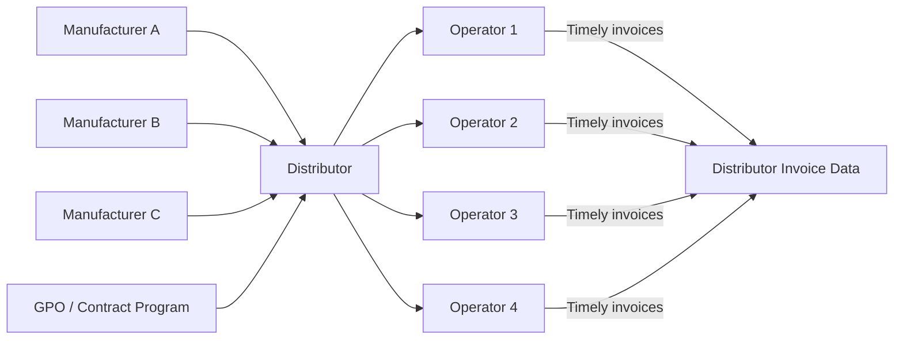
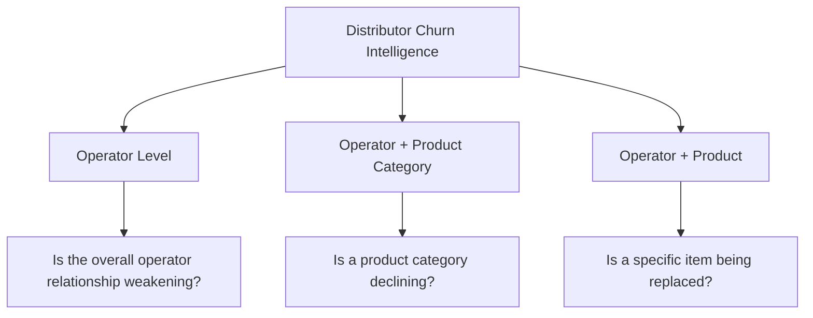
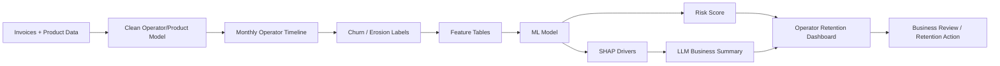
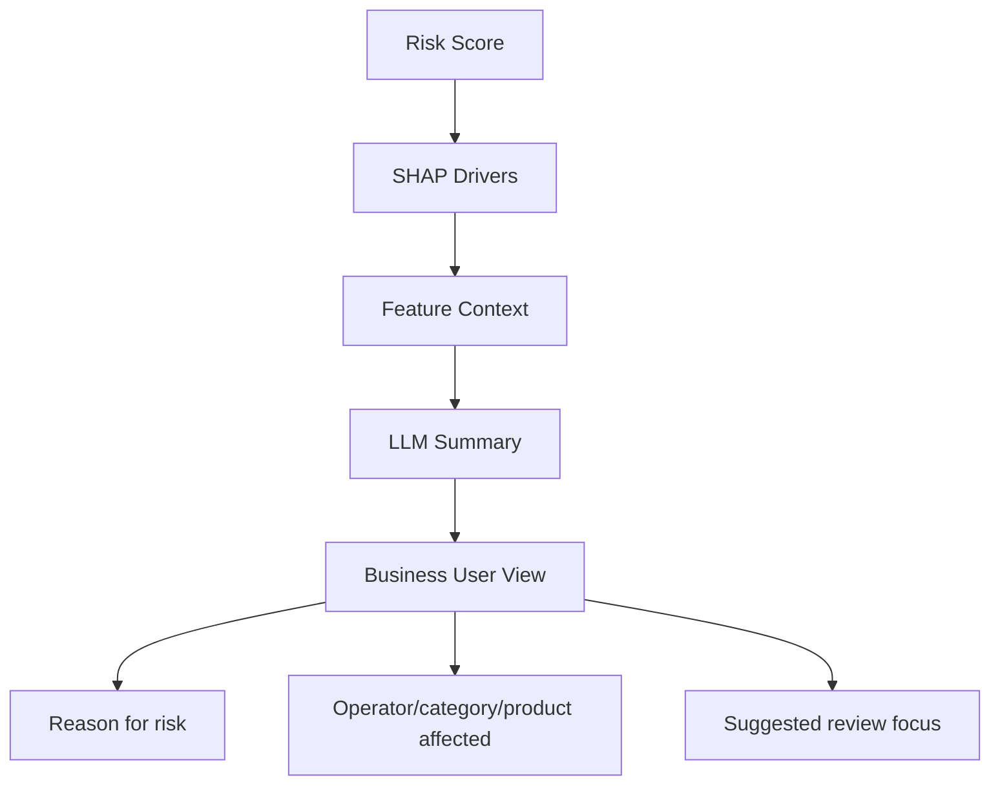

# Distributor Churn Intelligence

## Business Case Working Document

This document describes a reusable churn intelligence use case from the point of view of a distributor that sells directly to operators.

Unlike the manufacturer view, the distributor usually has direct and timely invoice visibility into operator purchases. This makes churn detection cleaner because the distributor can observe sales activity directly rather than waiting for downstream claims or indirect reporting.

## 1. Business Context

A distributor sells products directly to many operators. Those operators may buy the same product category from multiple manufacturers through the distributor.

For example, a distributor may sell paper plates to several operators. Those plates could be manufactured by different suppliers such as GP, Kimberly-Clark, Dart, Pactiv, or other manufacturers.

The distributor's operator may buy at a local, program-based, or operator-specific price. For this use case, the solution does not model commercial-program-level churn separately.

## 2. Distributor View Of The Market



From the distributor point of view, churn means:

> An operator is reducing, stopping, or shifting purchases away from the distributor, a product category, or a specific product.

Because the distributor owns invoice visibility, the distributor can detect changes faster than a manufacturer that depends on claims or downstream reporting.

## 3. Why The Distributor Use Case Is Different

The distributor churn use case differs from the manufacturer churn use case in several ways.

| Topic | Manufacturer View | Distributor View |
|---|---|---|
| Data visibility | Often indirect through claims or reports | Direct and timely invoices |
| Reporting lag | Can be material | Usually much lower |
| Operator relationship | Often indirect through distributor or channel path | Direct operator relationship |
| Churn question | Is the manufacturer losing demand? | Is the distributor losing operator wallet or category demand? |
| Competitive context | Other manufacturers may replace the product | Other distributors or channels may replace the distributor |
| Main workflow | Account retention and channel insight | Operator retention, category retention, sales insight |

## 4. Core Business Questions

The distributor churn intelligence solution should answer:

- Is this operator reducing purchases from the distributor?
- Is the decline across the whole operator relationship or only in one product category?
- Is the operator buying less or shifting to different products?
- What changed before the decline?
- What information would help the business team review the operator faster?

## 5. Important Product Manager Insight

The AI system should not be positioned as an automated negotiation engine.

Sales negotiation is still a human process because the salesperson often does not know:

- What competitor pricing the operator is seeing.
- What alternatives the operator is evaluating.
- What the operator is willing to disclose.
- What other channels the operator may be considering.

The AI should instead make the process:

- Simpler.
- Faster.
- More insight-driven.
- Easier to review during operator account reviews.
- More consistent across many operator reviews.

The goal is to support the salesperson with insights, not replace the salesperson's judgment.

## 6. Primary Use Case: Operator Retention Intelligence

The highest-value workflow is likely operator retention and category/product erosion monitoring.

Distributors may have thousands of active operators and product relationships. Business teams need to know which operators deserve attention and what changed before decline.

Typical review questions:

- Is this operator buying less than before?
- Are prices, margins, or discounts changing?
- Is the operator less active in key product categories?
- Are they still buying the same basket?
- Did their order frequency decline?
- Which accounts should the team prioritize first?

## 7. Churn Detection Levels

Distributor churn should be analyzed at multiple levels.



## 8. Data Foundation

A distributor-focused churn model should use direct transactional data where possible.

| Data Area | Purpose |
|---|---|
| Operator Master | Operator identity, hierarchy, segment |
| Invoice Header | Order date, invoice date, operator, branch |
| Invoice Line | Product, quantity, revenue, price, cost, margin |
| Product Master | Category, product family, pack, size |
| Cost / Margin Data | Profitability and price pressure |
| Operator Service / Delivery Data | Service issues that may explain churn |

## 9. Feature Engineering Approach

The feature store should be monthly and can support several grains:

- Operator x month.
- Operator x category x month.
- Operator x product x month.

Useful feature categories:

| Category | Example Signals | Business Meaning |
|---|---|---|
| Recency | days/months since last invoice | Whether the operator is still active |
| Frequency | order count, active weeks/months | Buying cadence |
| Revenue | monthly and rolling revenue | Relationship size and trend |
| Quantity | monthly and rolling units | Demand movement |
| Margin | gross margin, margin rate | Profitability and pricing pressure |
| Price | average sell price, price change | Operator price movement |
| Cost | cost changes | Whether margin pressure is external |
| Basket | unique products/categories | Breadth of relationship |
| Discount | discount or deviation from list | Commercial support level |
| Service | returns, credits, delivery issues | Operational dissatisfaction |
| Seasonality | month, quarter, season | Normal demand cycle |
| Lifetime | tenure, cumulative sales, historical peak | Operator value |

## 10. Modeling Flow



## 11. Label Options

Several label definitions may be useful.

| Label | Meaning | Use Case |
|---|---|---|
| Operator churn | No operator invoices in future period | Overall relationship risk |
| Category churn | No purchases in a product category | Category retention |
| Product churn | No purchases of a specific item | Item substitution |
| Revenue erosion | Revenue drops by a defined threshold | Early warning before full churn |

For a first version, use a simple next-month or next-period inactivity/erosion label, then expand by business level.

## 12. Explainability And Business Reasoning

The solution should explain:

- What drove the churn risk score up.
- What reduced the risk score.
- Whether the issue is total operator decline or only product/category decline.
- Whether price, margin, or product mix may be involved.
- Which business team should review the account.



The LLM should translate model drivers into business language. It should not invent competitor prices or prescribe final negotiation terms.

## 13. What The Dashboard Should Show

Recommended dashboard modules:

| View | User | Purpose |
|---|---|---|
| Executive Overview | Leadership | Revenue at risk, churn trend, high-risk operators |
| Operator Risk Queue | Sales / Pricing | Operators prioritized by risk |
| Operator Explorer | Business Users | Operator history, category trends, risk explanation |
| Category Risk View | Category Manager | Product/category erosion and product switching |
| Model Health | Analytics Team | Accuracy, recall, precision, drift |

## 14. Example Business Output

For a selected operator, the system might generate:

```text
This operator shows elevated churn risk because order frequency has declined and revenue in core disposable categories is below the recent average. The decline appears category-specific rather than a full relationship loss. The account should be reviewed with attention to category pricing, product substitution, and recent order pattern changes.
```

This should be paired with:

- Risk probability.
- Risk band.
- Revenue at risk.
- Top drivers.
- Affected categories.
- Supporting trend charts.

## 15. Success Criteria

The use case is successful when the distributor can:

- Detect operator decline earlier.
- Prioritize operator reviews.
- Understand whether risk is operator-wide or category-specific.
- Detect product or category switching.
- Give business teams better information before operator conversations.
- Reduce manual review time across many operators.
- Improve operator retention and margin protection.

## 16. Guiding Principle

The distributor AI solution should not say:

> Here is the exact price you must offer.

It should say:

> This operator deserves attention, these buying patterns changed, these categories or products are affected, and these are the facts the business team should review before acting.
