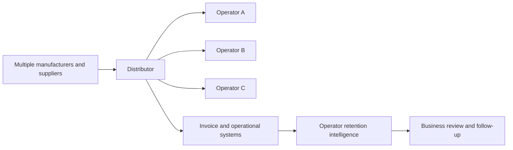
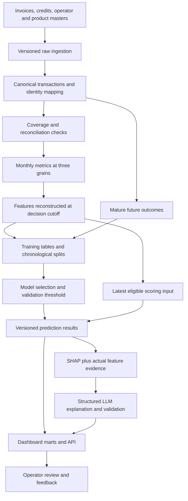

# Distributor Churn Intelligence: Reusable Solution Blueprint

Version: 2.0 | Updated: 2026-10-03 | Perspective: distributor

**Implementation status: proposed design. Distributor source data has not been supplied, and no distributor data pipeline, feature table, trained model, performance result, or live dashboard has been verified.** The manufacturer SQL is a reference for engineering patterns, not an implemented distributor solution. All `dist_*` names and distributor feature definitions below are proposed contracts.

This blueprint can be adapted to a distributor that sells directly to operators through invoices. Each implementation must map its own identifiers, invoice lifecycle, product structure, purchasing cadence, currencies, units, and data refresh schedule. Timely invoice visibility does not imply daily invoices, instantaneous ingestion, or complete historical data.

Use **operator** for the purchasing business throughout the data model and business interface. The three prediction levels are operator, operator + product line, and operator + product. A distributor may call its product line a category or family; map one agreed grouping to `product_line_id`.

## Contents

1. Business scope and decisions
2. Status and adaptation rules
3. End-to-end architecture
4. Source contract and canonical data model
5. Time, availability, and data quality
6. Monthly, snapshot, and training table contracts
7. Feature specification
8. Labels and eligible population
9. Model development and evaluation
10. Scoring and result contracts
11. SHAP and LLM explanations
12. Dashboard and operator workflows
13. Pipelines, deployment, and monitoring
14. Onboarding and acceptance gates
15. Reference workbooks and repository links

## 1. Business Scope And Decisions

### 1.1 Business flow



The distributor observes what an operator purchases from that distributor. It does not ordinarily observe the operator's full spending across competing distributors. A decline in observed purchases can be consistent with lower demand, normal buying cadence, product replacement, supply issues, pricing changes, or channel switching. A model score alone cannot identify which explanation is true.

### 1.2 Supported prediction levels

| Level | Logical snapshot grain | Business question | Scope of an inactivity label |
|---|---|---|---|
| Operator | Operator x snapshot month | Is the overall buying relationship weakening? | No qualifying purchases across the observed distributor assortment |
| Operator + product line | Operator x product line x snapshot month | Is one part of the basket weakening? | No qualifying purchases within that line |
| Operator + product | Operator x product x snapshot month | Is a specific item relationship weakening? | No qualifying purchases of that item |

There are no manufacturer-brand, contract/agreement, sales-rep/territory, location, distributor, or standalone product-only prediction levels in this scope. Ownership data may route a review without becoming a prediction level. Product and product-line dashboards aggregate operator relationships at their stated grain.

### 1.3 Decisions and boundaries

| Decision | Required evidence | Interpretation boundary |
|---|---|---|
| Prioritize operator reviews | Risk, recent spend, purchase pattern, freshness | A score is a prediction about the configured outcome |
| Locate erosion | Independent operator, line, and product scores and trends | Product inactivity does not establish whole-operator churn |
| Review a possible substitution | SKU decline, continued line activity, replacement mapping if available | A same-line purchase is only a possible substitute without supporting mapping |
| Investigate service or pricing context | Actual invoice price, returns, stockouts or service records | No price-causality or competitor-price claims from purchase data alone |
| Prepare an operator conversation | Concise evidence-backed reasons and transaction trends | Negotiation remains a human decision |
| Measure workflow value | Review outcomes and subsequent mature buying activity | Observed recovery after contact is not automatically caused by contact |

Example: an operator stops ordering one paper-plate SKU but continues purchasing other plate SKUs through the same distributor. The product relationship may become inactive while the product line and operator remain active. Present the three signals together.

## 2. Status And Adaptation Rules

| Area | Current status | Work needed for a distributor |
|---|---|---|
| Business use case | Discussed; distributor perspective agreed | Sign off buying cadence, action horizon, population and business terminology |
| Source data | Not supplied | Profile sample extracts and obtain field definitions and owners |
| Canonical tables | Proposed | Implement mappings, receipt history, invoice corrections and reconciliation |
| Monthly / snapshot / training tables | Proposed | Build and test the nine analytical tables |
| Models | No distributor models trained | Establish baselines and evaluate chronologically |
| SHAP / LLM | Design only | Implement against the selected distributor model and its feature dictionary |
| Dashboard | Requirements below | Connect governed distributor results after data acceptance |
| Production | Not implemented | Add orchestration, access control, release process and monitoring |

Reuse the manufacturer's three-layer structure, temporal evaluation approach, schema descriptions, and evidence-driven explanation design. Replace claim-specific calculations with invoice-specific definitions. Do not transfer model parameters, operational thresholds, reported accuracy, claim-completion features, or synthetic list-price assumptions as distributor defaults.

### 2.1 Configuration required for each distributor

| Configuration | What to decide | Standard behavior |
|---|---|---|
| `distributor_id` / tenant | Which organization's records are in scope | Isolate joins, access and outputs by tenant when hosting multiple distributors |
| Operator identity | Canonical ID and merge/split rules | Map source IDs without destroying history |
| Product-line definition | Category, family or line level | One effective mapping per product at the chosen level |
| Business timezone / calendar | Month boundaries and local transaction date | Store UTC availability timestamps and documented business dates |
| Qualifying purchase | Posted sale statuses, excluded documents, positive activity rule | Separate real purchases from voids, quotes, credits and adjustments |
| Revenue basis | Taxes, freight, discounts, returns and currency | Use reconciled merchandise values with one explicit convention |
| Unit basis | Product-specific conversions and compatible groups | Do not sum incompatible physical units across the basket |
| Data coverage | Feed scope, refresh cadence and closure rules | Unknown/incomplete coverage is not a zero-purchase month |
| Snapshot cutoff | When the decision could have been made | Filter source versions using availability at that cutoff |
| Prediction horizon | Next month or business-approved future interval | Start with one horizon; version every change |
| History eligibility | Required complete lookback and purchase evidence | Record reasons for ineligibility and short history |
| Feature policy | Core and optional fields permitted | Version a feature allowlist separately for each model |
| Threshold policy | Review capacity, costs and recall/precision needs | Select on validation; persist the threshold with the model |
| Explanation policy | Trigger, cache duration, output structure | Generate on demand or for prioritized changed cases |

## 3. End-To-End Architecture



Keep scoring features independent of label availability. A valid latest snapshot can be scored while its future label remains unknown. A training table is never the only source for current scoring.

## 4. Source Contract And Canonical Data Model

### 4.1 Minimum source requirements

Field names below are canonical requirements, not claims about an available source schema. A source owner must confirm their meaning before implementation.

| Source area | Required fields or equivalent | Why needed | Blocking behavior when absent |
|---|---|---|---|
| Invoice identity | Source system, invoice ID, invoice-line ID, record version | Deduplication and correction handling | Stop canonical build if a stable record key cannot be established |
| Operator linkage | Operator ID on the invoice or a valid header join | Assign purchases to the correct operator | Quarantine unresolved records and reconcile excluded value |
| Product linkage | Product ID on sale lines | Line/product grains and breadth | Product grains blocked until mapping is sufficient |
| Invoice lifecycle | Document type, posted/void/cancel status | Define qualifying purchases | Cannot assume every source row is a purchase |
| Event timing | Invoice business date | Activity month and purchase cadence | Resolve date semantics with source owner |
| Availability timing | First-received timestamp and timestamp for each revision | Historical feature reconstruction | Backtests cannot be called point-in-time verified |
| Sales value | Merchandise amount and currency, discount/tax/freight semantics | Comparable revenue and erosion | Reconcile revenue before modeling value features |
| Quantity | Quantity, UOM, pack/conversion metadata | Volume and item price features | Revenue/count MVP may proceed; quantity features remain unavailable |
| Product hierarchy | Product line and effective dates | Stable grouping through time | Reject ambiguous or overlapping mappings |
| Feed coverage | Expected feeds, observed loads, closure/completeness evidence | Distinguish no activity from missing data | Labels remain unknown for incomplete outcome windows |

### 4.2 Optional enrichment

| Data | Required detail | Features enabled | Missing-data policy |
|---|---|---|---|
| Order history | Stable order ID and accepted dates | Order frequency and reorder cadence | Invoice counts must not be renamed as orders |
| Cost of goods | Matched product/line cost and effective version | Gross profit and margin rate | Leave unavailable; do not fabricate margin |
| Actual list prices | Price, unit, currency and validity dates | Discount relative to a real commercial reference | No fixed multiplier as a substitute for a real list price |
| Credits and returns | Original document link, reason, amount, date and availability | Credit intensity and returned quantity | Missing feed is unknown, not no returns |
| Fulfillment | Ordered/delivered quantities and promise/actual dates | Fill, backorder and late delivery rates | Define denominator and outcome availability before use |
| Inventory / lifecycle | Available inventory, discontinuation and replacement dates | Supply interruption and replacement context | Cannot assert stockout or substitution without evidence |
| Operator profile | Segment and effective dates | Segment analysis and optional categorical inputs | Avoid using current profile states to describe past snapshots |

### 4.3 Canonical tables

| Proposed table | Physical key / grain | Contract |
|---|---|---|
| `raw_invoice_line_versions` | Source + invoice + line + available version | Immutable arrival and correction history |
| `dim_operator_history` | Canonical operator + validity interval + availability version | Identity mapping and historical profile |
| `dim_product_history` | Product + validity interval + availability version | Line membership, UOM and lifecycle context |
| `fact_invoice_line_versions` | Canonical invoice line + available version | Normalized sale/credit status, currency, quantity and amounts |
| `fact_credit_return_versions` | Credit/return line + available version | Optional linked return evidence without duplicate counting |
| `fact_fulfillment_versions` | Fulfillment event + available version | Optional service evidence |
| `feed_coverage` | Feed scope + business period + observation timestamp | Known completeness, reconciliation and latest successful load |
| `feature_dictionary` | Feature version + grain + field name | Description, formula, unit, source, availability, null policy and model role |
| `pipeline_runs` | Run ID | Inputs, cutoffs, versions, checks, output locations and status |

Canonical processing must reconcile merchandise sales, credits and net revenue back to the source. A header-to-line join must not multiply records. Corrections replace the relevant invoice-line version as known at the cutoff; they are not additional purchases. Currency conversion uses an approved historical basis. Cross-product quantity aggregation is enabled only for an explicitly compatible unit group.

## 5. Time, Availability, And Data Quality

### 5.1 The clocks to preserve

| Field | Meaning |
|---|---|
| `invoice_date` | Date of the qualifying commercial activity |
| `available_at` | When this record version became available to the platform |
| `snapshot_month` | First day of the activity month summarized by the snapshot |
| `feature_as_of_at` | Decision cutoff used to reconstruct all predictor evidence |
| `outcome_start` / `outcome_end` | Start-inclusive, end-exclusive target interval |
| `label_as_of_at` | Observation time used to determine whether the target is mature |
| `scored_at` | Actual scoring execution timestamp |

For the standard monthly experiment, use a cutoff at the start of the following month. A June snapshot has an invoice-event window ending just before July starts, and a July inactivity target. Only source versions available before the decision cutoff can contribute to features. Convert the local month boundary consistently to UTC.

```text
April              May                June              July              August
|------------------|------------------|-----------------|-----------------| 
<---------------- revenue_3m -------------------------->
                                                       ^ decision cutoff
                                                       <--- outcome ---->
                                                                          ^ label only when
                                                                            coverage is mature
```

If an invoice dated June arrives in July, it must not appear in a replay of the June-end decision. It can appear in a later reconstruction as known at that later cutoff. Select the latest record version available before the cutoff, rather than the latest version today.

Do not move the feature cutoff into the target month merely to wait for invoices while still calling the whole target month a future outcome. A different decision time requires an outcome interval that begins no earlier than that decision time, or a clearly labeled retrospective analysis. Significant delays between the intended cutoff and publication must be visible to business users.

### 5.2 Missing months, zero activity, and short history

- Build a calendar from the first observed qualifying purchase for each operator relationship through the configured snapshot horizon.
- Use zero for activity only when the corresponding source period has sufficient coverage and no qualifying purchases.
- Preserve an unknown coverage state when a feed is absent or incomplete; route it to data review and suppress ordinary retention alerts.
- Do not fill time before the first observed relationship with presumed non-purchases.
- Track complete months available for every required lookback. A new relationship and a missing data month are different states.
- A twelve-month feature requires twelve complete comparable months. Unavailable long windows remain null, accompanied by coverage metadata.
- Lifetime features mean observed history through the cutoff, not the operator's true lifetime or future history.

### 5.3 Quality checks before publication

| Check | Expected behavior |
|---|---|
| Unique invoice and snapshot keys | Reject duplicates after correction/deduplication rules |
| Join reconciliation | No unexplained line multiplication or revenue loss |
| Dates and availability | Reject invalid dates; retain genuinely late arrivals |
| Product mapping | Exactly one usable line mapping for each scored product at the relevant time |
| Units and currencies | No incomparable amounts or units in one aggregate |
| Completeness | Verify expected feeds; maximum invoice date alone is insufficient |
| Optional source availability | Keep missing enrichment null and record the reason |
| Historical replay | A later-arriving record cannot change a frozen earlier feature build |
| Feature descriptions | Every released field has a definition and model-role metadata |

## 6. Monthly, Snapshot, And Training Table Contracts

### 6.1 Proposed tables

| Layer | Operator | Operator + product line | Operator + product |
|---|---|---|---|
| Monthly metrics | `dist_operator_monthly_metrics` | `dist_operator_product_line_monthly_metrics` | `dist_operator_product_monthly_metrics` |
| Snapshot features | `dist_operator_snapshot_features` | `dist_operator_product_line_snapshot_features` | `dist_operator_product_snapshot_features` |
| Churn training | `dist_operator_churn_training` | `dist_operator_product_line_churn_training` | `dist_operator_product_churn_training` |

The business grain is the entity relationship and month. Physical history also retains a `snapshot_build_id` or equivalent version so that a rebuild cannot silently overwrite what a previous model saw. Multi-distributor hosting adds tenant identity to all physical keys; it does not add a churn level.

### 6.2 What each layer contains

| Layer | Contents | Examples | Does it contain the future target? |
|---|---|---|---|
| Monthly metrics | Single-month measures under an explicit source cutoff | Sale revenue, distinct invoices, purchase days, product breadth, optional margin | No |
| Snapshot features | Monthly values plus historical lags, rolling measures, recency, trends and coverage | Prior revenue, three-month spend, days since purchase, breadth change | No |
| Churn training | Eligible historical snapshot features joined to mature outcome labels and split metadata | `churn_label`, `outcome_start`, `label_status`, `dataset_split` | Yes, in explicitly excluded target/helper fields |

A snapshot table is already a feature table. There is no separate fourth core layer called a "feature table" in this design. A model input view selects an approved subset of snapshot columns without redefining their formulas. The reference workbooks distinguish columns from actual model predictors.

Recommended training preparation retains an auditable label-status table for every candidate snapshot. Only mature, eligible rows enter the training table. Scoring selects from snapshot features and records why a row is scored, suppressed, dormant, or not eligible.

### 6.3 Metadata on every release

Retain tenant ID, entity keys, snapshot month, cutoff, build ID, feature version, source data version and lineage. Training adds label-definition version, label observation cutoff and split policy. Predictions add model version, threshold policy/version, actual score time and explanation status.

Create schema descriptions explicitly or publish them from the versioned feature dictionary. Do not assume that descriptions survive a table transformation automatically. Preserve precision for calculations and probabilities; format business displays to two decimals where meaningful.

## 7. Feature Specification

### 7.1 Proposed core monthly metrics

| Feature | Definition | Business value | Applicable grains |
|---|---|---|---|
| `sale_revenue_1m` | Posted qualifying sale-line merchandise value after invoice discounts, before credits, excluding configured tax/freight | Recent buying value | All |
| `credit_amount_1m` | Positive merchandise credit magnitude posted in the month under the approved credit policy | Financial adjustment context | All, conditional on credit coverage |
| `net_revenue_1m` | Sale revenue less matched in-scope credit amounts, each recorded in its posting month | Net commercial value | All, conditional on complete credit coverage |
| `invoices_1m` | Distinct qualifying invoice keys containing at least one sale at the row grain | Purchase-document frequency | All |
| `invoice_lines_1m` | Qualifying sale lines after deduplication | Basket detail, distinct from invoice/order frequency | All |
| `purchase_days_1m` | Distinct invoice business dates with qualifying purchases | Buying cadence | All |
| `last_purchase_date` | Most recent qualifying purchase date at or before the cutoff, across observed history | Recency helper | All |
| `unique_products_1m` | Distinct qualifying product IDs in the month | Assortment breadth | Operator and operator-line |
| `unique_product_lines_1m` | Distinct qualifying line IDs in the month | Category breadth | Operator |
| `top_product_revenue_share_1m` | Largest product sale revenue divided by positive total sale revenue | Basket concentration | Operator and operator-line |
| `top_product_line_revenue_share_1m` | Largest line sale revenue divided by positive total sale revenue | Line concentration | Operator |
| `is_active_1m` | One if at least one qualifying purchase exists | Purchase activity independent of net credit effect | All |
| `purchase_qty_base_1m` | Positive purchased quantity converted to the product's canonical base UOM | Volume independent of unit price | Operator-product; other grains only under a compatible-unit extension |
| `realized_unit_price_1m` | Sale revenue divided by positive base quantity for the same product/unit/currency | Actual item price context | Operator-product |

Credits must not turn an actual purchasing month into inactivity simply because net revenue is zero or negative. `invoice_lines_1m` is not an order count. If an invoice spans several product lines, it is counted once within each affected line; summing those line counts does not reproduce the distinct operator invoice count.

### 7.2 Snapshot and trend definitions

Let `t` be the snapshot month, and let `R(t)` be `sale_revenue_1m` for that entity at the snapshot's availability cutoff. Lookbacks include `t` unless named prior-only. Monthly aggregates reused in a historical window must all be reconstructed under that same cutoff.

| Feature family | Example / formula | Availability and interpretation |
|---|---|---|
| Monthly lag | `prev_sale_revenue_1m = R(t-1)` | Previous calendar month, not previous nonempty row |
| Rolling spend | `sale_revenue_3m = R(t) + R(t-1) + R(t-2)` | Null if required source coverage is incomplete |
| Rolling invoice count | Distinct qualifying invoice keys in the full lookback | Recompute over transactions; invoice identity and correction rules must be stable |
| Monthly average | `avg_sale_revenue_3m = sale_revenue_3m / 3` | Requires three complete months; known zero months are included |
| Growth | `(R(t)-R(t-1))/R(t-1)` | Null when baseline is zero or unavailable; values are fractions |
| Absolute movement | `R(t)-R(t-1)` | Retain alongside growth for economic scale |
| Recent versus prior | Sum `t..t-2` versus sum `t-3..t-5` | Requires six complete months; the windows do not overlap |
| Volatility | Population standard deviation / mean of complete monthly spend | Null with a zero mean; history requirements documented |
| Recency | Days between cutoff business date and last qualifying purchase date | Uses only prior observable purchases |
| Activity consistency | Active months / complete months in the required window | Do not divide partial history by a full-window length |
| Monthly breadth average | Average monthly distinct products across the window | Different from distinct products bought anywhere in the window |
| Window breadth | Distinct products across all qualifying transactions in the window | Must not sum monthly distinct-product counts |
| Seasonality | `sin(2*pi*month/12)` and `cos(2*pi*month/12)` | Calendar descriptors; short datasets cannot establish annual seasonality |
| Lifetime baseline | Cumulative observable sale revenue through cutoff / complete observed months | Describe as observed lifetime; record the history start |
| Same month last year | `R(t-12)` and its comparison with `R(t)` | Requires complete comparable history and stable identity/product mapping |

Use two-, three-, six-, and twelve-month features only where sufficient history and incremental validation value justify them. Exact sixty- or ninety-day windows are optional transaction-level features with date boundaries; they are not synonyms for two or three calendar months.

### 7.3 Relationship context and optional features

| Feature | Interpretation | Required evidence |
|---|---|---|
| `line_share_of_operator_revenue_1m` | Share of the operator's observed spend in this line | Operator and line sales built at the same cutoff |
| `product_share_of_line_revenue_1m` | Share of the operator's line spend in this product | Product and line sales at the same cutoff |
| `other_products_revenue_in_line_1m` | Remaining line sales after removing this product | Same denominator and eligible sale policy |
| `product_down_line_stable_flag` | Product spend declined while total line spend did not | Both periods complete; diagnostic pattern, not proof of substitution |
| `gross_profit_1m`, `gross_margin_rate_3m` | Profitability context | Reconciled sales and matching historical cost |
| `late_delivery_rate_3m` | Late deliveries / eligible completed deliveries | Promise dates and observed delivery outcomes available before cutoff |
| `fill_rate_3m` | Fulfilled units / requested units under compatible UOM | Order/fulfillment linkage and source coverage |
| `credit_to_sales_ratio_3m` | Posted credit magnitude / qualifying sale revenue | Full credit feed; current credits can relate to older sales |
| `replacement_product_observed_flag` | Purchase of a mapped replacement product | Effective and available product replacement mapping |
| Observed portfolio share/rank | Relative position among operators visible to this distributor | Consistent same-cutoff comparison population; no industry-share claim |

Do not compute an all-basket average price by dividing revenue by a mixture of cases, individual units and weights. SKU price movement and a separately designed matched-product price index are more interpretable. Gross margin movement can reflect product mix or cost; it does not establish a reason for an operator to leave.

### 7.4 Feature release rules

Every feature needs a name, type, grain, formula, unit, source dependency, availability rule, null/zero policy, intended behavioral use and training role. The proposed distributor workbook supplies those definitions. Optional source fields remain conditional candidates until data and evaluation support them.

Exclude identifiers, cutoffs, build versions, outcome dates, labels, future aggregates, split labels and administrative status from predictor inputs. Use one feature manifest for fitting, batch scoring, on-demand scoring and SHAP. Remove duplicates or weak features through training/validation experiments; low global attribution alone is insufficient justification for removal.

## 8. Labels And Eligible Population

### 8.1 First target

For each supported entity relationship, the initial proposed target is **next-month observed purchase inactivity**:

```text
churn_label = 1: zero qualifying purchases in the complete future outcome interval
churn_label = 0: one or more qualifying purchases in that interval
label unknown: outcome not finished, source not complete, or identity not resolvable
```

Define a qualifying purchase from accepted posted sale documents. A valid positive purchase line must satisfy the agreed status and quantity/value policy. Credit-only, voided, draft or duplicate records do not create purchases. Free-of-charge goods and zero-value lines require an explicit business rule.

One inactive month can be normal for infrequent purchasers. Validate the horizon by segment and item cadence before describing the score as churn. The UI should say "risk of no purchases next month" until the business has validated a stronger churn interpretation.

### 8.2 Eligibility and maturity

| Population / status | Proposed handling |
|---|---|
| Active relationship with complete required history | Eligible for the first new-inactivity model |
| Already dormant at the snapshot | Report a separate dormant status; exclude from the first new-inactivity model |
| New relationship with insufficient history | Show insufficient history; consider a separately evaluated new-operator model later |
| Missing feature-period coverage | Suppress normal prediction; report data incomplete |
| Future period not finished | Keep snapshot scoreable; label unknown |
| Future period finished but feed incomplete | Label unknown until coverage evidence is accepted |
| Mapped discontinued/replaced product | Apply documented scope policy; avoid automatic operator-loss interpretation |

The first proposal uses `is_active_1m = 1` as the active risk set. An extension may use a cadence-based recent-active rule, but it changes the population and must be versioned. Do not silently mix new inactivity and ongoing dormancy in one reported metric.

Label maturity uses outcome completion plus verified source coverage at `label_as_of_at`. A calendar delay can be a conservative supporting rule; it cannot prove that a missing feed is complete. During a backtest, training labels must have been mature by the simulated model-fit date. Apply a horizon/maturity gap when needed between training outcomes and a later validation decision.

### 8.3 Optional erosion target

After inactivity is validated, consider a separate target for a business-approved drop in future sale revenue versus a trailing baseline. Configure the baseline window, minimum baseline value, drop fraction, seasonality treatment and outcome maturity. Keep its label version, model and dashboard meaning separate. An erosion probability is not a predicted amount of lost revenue.

## 9. Model Development And Evaluation

### 9.1 Model plan

| Candidate | Purpose | Release condition |
|---|---|---|
| Prevalence / rule baseline | Establish value beyond simple recency and buying-cadence rules | Evaluated on the same mature population and dates |
| Logistic regression | Interpretable statistical baseline | Training-only preprocessing and stable temporal validation |
| Boosted trees, including BQML | Main tabular candidate | Improvement on validation and acceptable behavior across time |
| CatBoost / LightGBM | Optional Python candidates | Same feature contract, splits, target and evaluation policy |

Train independent models for the three supported grains. Begin with the operator model, then add line and product models once the source and product mapping pass checks. Algorithm choice remains open until source data and evaluation are available; no distributor winner or achieved metric is claimed here.

### 9.2 Chronological experiment design

1. Freeze source versions, feature definitions, population and label maturity policy.
2. Build monthly historical cutoffs and reproduce what was available at each one.
3. Train on earlier mature snapshots; validate on later snapshots.
4. Fit imputation, encoding, scaling and class weights using training data only.
5. Tune parameters, feature subsets, early stopping, calibration and thresholds without using test results.
6. Prefer rolling-origin validation when enough history exists; retain a final untouched chronological test or prospective period.
7. Store run metadata, feature manifest, exact training dates, evaluation results and artifacts.

The same operator can appear at different times in a time-based split when the intended task is future behavior of existing operators. If the business also needs unseen-operator generalization, add a separate evaluation for that population. Do not randomly mix adjacent snapshots and call it temporal validation.

Evaluate tree depth, learning rate, number of trees, minimum leaf evidence, regularization and sampling using the chosen engine's supported options. Shallower trees or stronger regularization may reduce overfitting, but increasing training accuracy is not evidence of improvement. Compare equal-threshold performance and validation-selected operating points.

### 9.3 Evaluation report

| Metric / diagnostic | Interpretation |
|---|---|
| Label prevalence by month | Detect changes in population, cadence or data maturity |
| Precision and recall | Quality and coverage of the review queue |
| F1 and confusion matrix | Threshold-dependent balance and error counts |
| Average precision / PR curve | Ranking performance with positive prevalence stated alongside it |
| ROC AUC | Ranking discrimination; not probability accuracy |
| Log loss / calibration / Brier score | Reliability of probability estimates |
| Precision and recall at queue capacity | Operational usefulness under limited review capacity |
| Captured historical sales exposure | Value attached to detected relationships; no guaranteed future loss |
| Performance by time and segment | Stability and failure cases |
| All-positive and all-negative baselines | Guard against misleading scores under extreme imbalance |

Select thresholds using validation and business review capacity/cost. Class weighting can alter probability calibration, so verify probability quality. Keep test data out of threshold selection. If results repeatedly guide experimentation, obtain a fresh holdout before claiming final generalization.

## 10. Scoring And Result Contracts

### 10.1 Batch and on-demand behavior

Batch scoring refreshes predictions when a new eligible feature cutoff is published. A dashboard request normally reads those cached scores. On-demand scoring may compute a selected operator's three-grain predictions from the same released feature version; it does not retrain a model or magically add fresher source evidence.

An on-demand explanation can run after a cached prediction is retrieved. Show source freshness, feature cutoff, score time and explanation time separately. A fast UI refresh is not evidence that invoice data has refreshed.

### 10.2 Output tables

| Proposed table | Key / grain | Main fields |
|---|---|---|
| `dist_churn_predictions` | Tenant + grain + entity keys + snapshot + model/build version | Probability, threshold, decision, eligibility, model and feature versions, score time |
| `dist_churn_driver_attributions` | Prediction key + feature | Raw attribution, normalized churn direction, actual value, comparison evidence, scale and rank |
| `dist_churn_explanation_context` | Prediction key + context version | Approved evidence and descriptions sent to the LLM |
| `dist_churn_explanations` | Prediction key + prompt/model/context version | Validated structured business explanation, status and generation metadata |
| `dist_operator_history` | Operator + activity month + data version | Reconciled activity series for charts |
| `dist_operator_relationship_risk` | Operator + line/product relationship + prediction key | Detail table for drilldown |
| `dist_churn_model_metrics` | Model version + period + evaluation policy | Mature metrics, threshold and population |
| `dist_operator_review_feedback` | Review event ID + prediction key | Reviewer disposition, follow-up status, evidence and subsequent outcomes |

Store full precision probabilities. Distinguish the statistical model probability from threshold-based risk bands. If `operator_id`, `product_line_id` or `product_id` is not applicable to a row grain, use a documented null policy in the shared result table.

Cache explanations by tenant, grain, entity, snapshot build, model version, threshold version, prompt version and evidence hash. Never overwrite one shared on-demand table per request; use stable keys or request IDs to handle simultaneous users and preserve history.

## 11. SHAP And LLM Explanations

### 11.1 SHAP contract

SHAP explains model contributions relative to a baseline. It does not establish a causal business reason. Preserve the explained class, raw output scale, baseline and attribution method. Normalize direction so every business-facing driver consistently means an increase or decrease in class-1 inactivity risk. Never interpret log-odds attribution as percentage points.

For each displayed driver attach the actual feature value, appropriate comparison when claiming a change, the feature definition, units, availability caveat and evidence identifier. A top-k list is a partial view; omitted contributions can prevent the displayed subset from summing to the full prediction. Global importance is not an explanation for one operator.

### 11.2 LLM context and output

The LLM receives a selected prediction and curated evidence, not unrestricted access to all commercial data. The context includes the prediction grain, target meaning, history and coverage status, feature values, descriptions, comparisons and normalized risk directions.

Business-facing prose should normally contain a brief summary and up to three or four supported reasons, without numeric detail or recommended actions. Quantitative evidence remains available in adjacent charts and tables. Fewer supported reasons are preferable to invented reasons.

Proposed validated response contract:

```json
{
  "schema_version": "1.0",
  "summary": "The operator is showing a weaker purchasing pattern.",
  "reasons": [
    {
      "title": "Purchasing has become less frequent",
      "detail": "Recent invoice activity is below the operator's earlier pattern.",
      "risk_direction": "increases_risk",
      "business_theme": "purchase_frequency",
      "evidence_ids": ["driver_invoices_change"]
    }
  ],
  "caveat": "The prediction describes possible future inactivity, not confirmed departure."
}
```

This is an illustrative shape, not an observed distributor explanation. Validate required fields, types, allowed directions, reason-count limit, and evidence IDs before publishing. Validate that direction matches SHAP and that comparative claims have actual comparison evidence. Invalid JSON, model errors and missing evidence must produce a visible explanation status and a deterministic evidence fallback, not empty reason cards.

Do not infer competitor prices, lost contracts, stockouts, dissatisfaction, or confirmed substitution without supporting source evidence. Do not describe a low-risk operator as already churned. Describe model confidence using calibration and data sufficiency evidence where available; SHAP strength alone is not confidence.

## 12. Dashboard And Operator Workflows

### 12.1 Business-facing views

| View | Main components | Interaction |
|---|---|---|
| Portfolio overview | Eligible active operators, flagged operators, historical sales exposure, risk trend, freshness | Filter snapshot and risk status, then open an operator |
| Operator queue | Searchable operator list, risk, exposure, recent trend, explanation status | Sort by approved priority, inspect evidence, record review |
| Operator workspace | Operator prediction, concise LLM reasons, revenue/invoice history, breadth and data-status panels | Select an operator and move among overall, line and product detail |
| Product-line detail | Operator-line risks, line sales trends, basket composition | Drill into the selected operator's products within a line |
| Product detail | SKU risk, quantity/unit-price trend where valid, line context | Review item loss versus wider relationship behavior |
| Review history | Prior scores, business dispositions, follow-up and outcomes | Preserve traceable feedback |

Keep technical model-health views in an analyst/administrative area. Business users need freshness, coverage and explanation status in the main workflow; they do not need training logs mixed into the main reasons panel.

### 12.2 Charts and useful tables

- Monthly sale revenue and invoice count with the selected snapshot clearly marked.
- Product-line spend composition for the selected operator, showing concentration changes.
- Product activity table with last purchase, prior/recent sales, risk, and supported replacement context.
- Driver chart with plain-English feature labels and explicit risk direction.
- Historical score trend only across compatible model/feature versions, or with change markers.
- Coverage and short-history indicators so missing data does not look like lost demand.

Observed future outcomes may be shown during retrospective review if clearly separated from the historical prediction evidence. Do not feed those outcomes back into the original explanation prompt.

### 12.3 KPI definitions

| KPI | Definition | Guardrail |
|---|---|---|
| Flagged operators | Distinct eligible operators above the operator threshold | Do not count product/line signals as additional operators |
| Flagged relationships | Number of flagged operator-line or operator-product pairs | Always label the selected grain |
| Historical sales exposure | Trailing observed sales attached to flagged relationships | It is not a forecast of lost revenue |
| Mature inactivity rate | Positive labels / mature eligible outcomes | Exclude unknown labels from numerator and denominator |
| Review completion | Reviewed cases / assigned cases for the same workflow period | Preserve assignment and review timestamps |
| Subsequent recovery | Observed post-review buying under a defined follow-up window | No causal retention claim without an appropriate study |

Operator, line and product exposures overlap. Choose one non-overlapping grain for an aggregate total. Do not sum all three or average lower-level probabilities into an operator probability; the operator model supplies its own probability.

### 12.4 Serving choices

A BI dashboard can read prepared marts. A web application can provide search, on-demand explanation jobs, workflow status and review feedback through an API. Either choice should serve the same published table contracts. A first implementation can use either; the blueprint does not require both.

## 13. Pipelines, Deployment, And Monitoring

### 13.1 Run sequence

| Stage | Trigger | Publish only after |
|---|---|---|
| Ingest | Agreed source cadence | Versioned loads and source reconciliation succeed |
| Canonicalize | Successful ingestion | Identity, document status, currency and unit checks pass |
| Build monthly/snapshot tables | Configured cutoff | Unique grain, coverage and historical-availability checks pass |
| Mature labels | Outcome and coverage become available | Outcome completeness and population rules pass |
| Train / validate | Scheduled review or approved experiment | Temporal evaluation and baseline comparison pass |
| Score | New released feature snapshot | Manifest, types, model and threshold versions match |
| Explain | Operator request or prioritized score change | Evidence is valid and generated output passes schema checks |
| Serve | Successful publication | Dashboard totals and entity joins reconcile |

Use environment configuration for projects, datasets, storage, schedules and model locations. Keep development, test and production outputs isolated. Build versioned staging outputs, validate them, then publish a serving reference. Preserve the prior release for rollback. A retry should not duplicate invoices, scores or explanations.

### 13.2 Engineering responsibilities

| Area | Required capability |
|---|---|
| Data engineering | Ingestion, source mappings, version history, coverage, feature and label jobs |
| ML engineering | Feature manifests, reproducible experiments, model/threshold registry, scoring and drift review |
| Application engineering | APIs, dashboard marts, request status, caching and feedback |
| Platform operations | Scheduling, deployment pipeline, logs, credentials, access and recovery |
| Business ownership | Target meaning, eligibility, review capacity, false-alert investigation and acceptance |

Roles can be combined on a small team, but the responsibilities remain. Keep warehouse credentials and generation endpoints behind the service layer. Apply operator-data access and tenant isolation consistently to warehouse queries, caches, explanations and dashboards.

### 13.3 Monitoring and cost controls

Track source timeliness, expected-feed coverage, unknown IDs, unmatched units, revenue reconciliation, feature missingness, score distribution and model/feature version consistency. Evaluate model quality only when labels mature. Investigate reporting or source changes before assuming a model has degraded.

Track LLM schema-validity rate, unsupported-evidence failures, latency, cache hits and generation cost separately. Default to cached scores and on-demand explanations; batch only prioritized new or materially changed cases. Limit the evidence payload and top drivers. Do not generate fresh prose for every operator on each dashboard refresh.

## 14. Onboarding And Acceptance Gates

| Phase | Concrete deliverable | Acceptance gate |
|---|---|---|
| Discovery | Source samples, data owners, target/population agreement, gap register | Operators, activity and time semantics are unambiguous |
| Canonical foundation | Mapped/versioned invoices and dimensions, coverage ledger | Reconciled totals and valid historical joins |
| Feature pilot | Three-grain monthly and snapshot tables with dictionary | Unique keys, correct windows, replay availability, coverage flags |
| Operator model pilot | Mature labels, baselines, temporal validation | Useful queue performance and understandable failures |
| Line/product extension | Grain-specific models and evaluation | Cadence and replacement effects checked at each grain |
| Explanation pilot | Selected operators with SHAP and validated LLM summaries | Each reason traces to correct-class evidence |
| Dashboard integration | Search, drilldown, trends, reasons, status and feedback | Business users can review an operator without ambiguous totals |
| Production release | Automated jobs, deployment, monitoring and rollback | Repeatable runs, access tests, reconciliation and owner sign-off |

Before implementation, answer these questions for each distributor:

1. Which source fields and document statuses establish a genuine purchase?
2. How are operator identities merged, and how much history is reliable?
3. What product grouping, effective mapping and replacement information exist?
4. What revenue, currency and unit conventions reconcile with business reporting?
5. When are invoices and corrections received, and how is completeness established?
6. What reorder intervals make a one-month inactivity label actionable?
7. Which optional cost, credit, service and inventory feeds are actually available?
8. How many cases can users review, and what threshold tradeoff is acceptable?
9. What evidence may the LLM use, and what access restrictions apply?
10. Which owner accepts each release and investigates source/model issues?

No delivery date or accuracy target can be committed from the blueprint alone. The first implementation milestone is source acceptance and a small reconciled historical replay.

## 15. Reference Workbooks And Repository Links

The `outputs` reference package distinguishes implemented manufacturer SQL from proposed distributor definitions. Both cover monthly metrics, snapshot features, training columns and three-grain feature presence. The distributor workbook additionally lists source requirements and calculation/null/availability rules. Counts describe proposed catalog entries, not fields already available in a source or predictors already selected by a trained model.

| Reference | Purpose |
|---|---|
| [Distributor business case](distributor_churn_business_case.md) | Original business context and product-manager discussion |
| [Manufacturer blueprint](manufacturer_churn_solution_blueprint.md) | Implemented claims-based prototype and reusable standards |
| [Manufacturer operator SQL](../sql/operator_level/README.md) | Existing manufacturer implementation reference |
| [Manufacturer product-line SQL](../sql/operator_product_line_level/README.md) | Existing manufacturer implementation reference |
| [Manufacturer product SQL](../sql/operator_product_level/README.md) | Existing manufacturer implementation reference |

When source data arrives, update the source mapping and feature catalog first. Mark each proposed feature as implemented, blocked, optional, or rejected with a reason, then implement and verify the distributor pipeline against that accepted contract.
