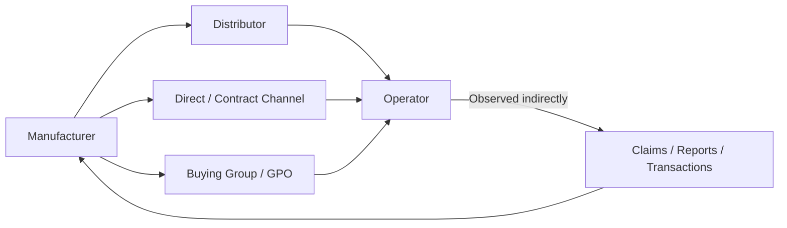
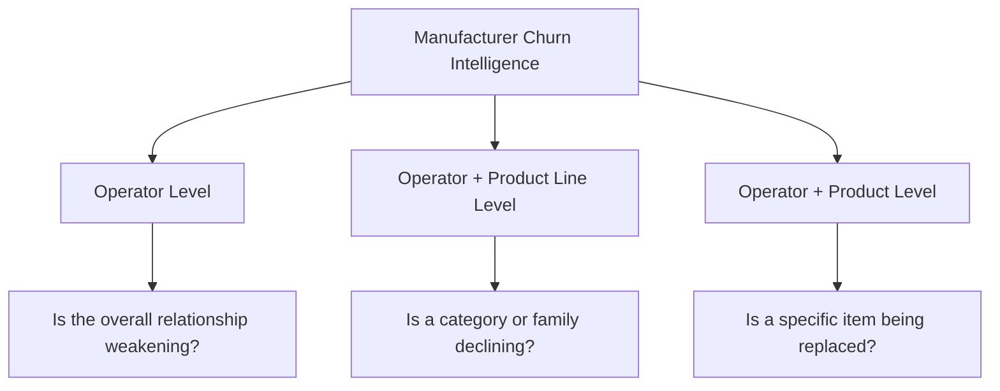
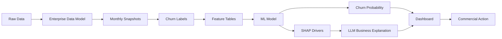
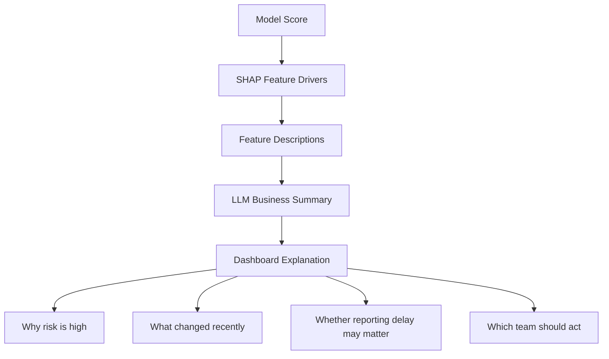
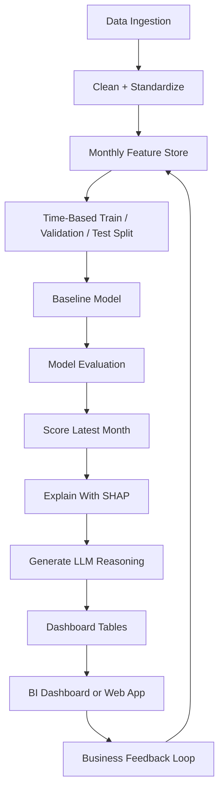

# Manufacturer Churn Intelligence

## Business Working Document

This document describes a reusable churn intelligence approach for B2B manufacturers that serve operators through commercial programs, distributor fulfillment paths, buying groups, direct channels, and other sales paths.

The goal is to help a manufacturer detect operator demand erosion early, understand why it may be happening, and guide the right commercial team to act.

## 1. Business Context

Many manufacturers do not see demand through one clean path. An operator may buy through:

- A distributor.
- A direct relationship.
- A buying group or GPO.
- A national or local contract.
- A special pricing or commercial program.
- Street sales or non-contracted purchases.

Because of this, the manufacturer often sees only part of the operator relationship. Transaction visibility may come from claims, billbacks, distributor reports, invoices, contract data, or internal sales systems.

Churn is therefore not always a clear event. It may first appear as a decline in one product line or one product before it is visible at the total operator level.

## 2. Manufacturer View Of Demand



From the manufacturer point of view, churn means:

> The operator appears to be reducing or stopping demand for the manufacturer's products based on observable data.

For this use case, say **operator** instead of customer. Manufacturer-observed operator churn is not always the same as true demand loss. The operator may still be buying through another path, reporting may be delayed, or identifiers may have changed.

## 3. Why Churn Is Difficult

Manufacturer-observed churn can be confused with several business realities:

- Distributor reporting delays.
- Missing claims or incomplete billback files.
- Distributor switching.
- Product substitutions.
- Operator identifier changes.
- Seasonal buying patterns.
- True competitive loss.

The solution must separate likely behavior change from likely data/reporting noise.

## 4. Key Business Questions

A churn intelligence solution should answer:

- Is the operator truly reducing demand, or changing how they buy?
- Is the decline happening at the total operator level, product line level, or product level?
- What changed before the decline?
- Is the signal caused by pricing, product mix, seasonality, or reporting delay?
- Which commercial team should respond?
- What revenue is at risk?

## 5. Churn Detection Levels

Churn should be viewed at multiple levels because relationship erosion often starts below the total operator level.



## 6. Common Churn Drivers

Likely drivers include:

- Demand decline from the operator.
- Product substitution.
- Product discontinuation.
- Competitive conversion.
- Price increase or price mismatch.
- Discount reduction.
- Distributor service issue.
- Distributor switch.
- Weak sales engagement.
- Delayed or missing reporting.

## 7. Data Foundation

A reusable manufacturer churn model usually needs these building blocks:

| Data Area | Purpose |
|---|---|
| Operator Master | Defines the operator and hierarchy |
| Transaction / Claim Header | Provides reporting, distributor, and timing context |
| Transaction / Claim Line | Provides product, quantity, revenue, and price behavior |
| Product Master | Groups items into product lines and families |
| Cost / List Price Data | Supports margin, discount, and billback analysis |
| Sales Territory / Owner | Routes action to the right team |

## 8. Monthly Feature Store

The recommended analytical unit is a monthly snapshot:

```text
one row per operator or operator-product segment per snapshot month
```

Examples:

- Operator x month.
- Operator x product line x month.
- Operator x product x month.

## 9. Feature Categories

Useful feature layers include:

| Category | Example Signals | Business Meaning |
|---|---|---|
| Recency | months since last purchase | How recently the operator bought |
| Frequency | active months, transaction count | Whether buying cadence is weakening |
| Revenue | 1m, 3m, 6m revenue | Size and trend of relationship |
| Quantity | unit volume trends | Demand movement independent of price |
| Pricing | average price, price changes | Whether price pressure may be involved |
| Discount | discount rate, billback amount | Whether economic support changed |
| Product Mix | unique products, product line share | Whether assortment is shrinking |
| Concentration | top product or product-line share | Whether demand depends on a narrow set of products |
| Reporting | claim delay, completion rate | Whether data lag could explain the signal |
| Seasonality | month, quarter, cyclic indicators | Normal seasonal buying behavior |
| Lifetime | tenure, cumulative revenue | Operator value and history |
| Market Share | operator share vs market | Relative position within the observable market |

## 10. Modeling Flow



## 11. Churn Labeling

For a first version, churn can be labeled as:

> No observed activity in the next month.

More advanced versions can support:

- 2-month or 3-month inactivity.
- Product-line churn.
- Product churn.
- Revenue-decline labels rather than complete inactivity.

Labels should be built using only future periods needed for the target, while model features must use only information available at the snapshot date.

## 12. Explainability Approach

The model should produce:

- A churn probability.
- Top drivers increasing churn risk.
- Top drivers reducing churn risk.
- Recent behavior changes.
- Reporting/data caveats.
- Suggested owner or response team.



SHAP explains which features contributed to the model score. The LLM should not invent facts. It should translate the model drivers and feature values into concise business language.

## 13. Dashboard Views

Recommended dashboard modules:

| View | Audience | Purpose |
|---|---|---|
| Executive Overview | Leadership | Total risk, revenue at risk, trend |
| Risk Queue | Sales / Pricing | Prioritized list of at-risk operators |
| Operator Explorer | Account Teams | Detail view for one operator |
| Driver Explanation | Business Users | Plain-English churn reasons |
| Product / Category View | Product Teams | Identify item or line erosion |
| Model Health | Analytics Team | Accuracy, precision, recall, drift |

## 14. Example Business Output

For a selected operator, the final system should produce a concise summary like:

```text
Operator risk is elevated because recent purchase frequency and revenue have declined compared with prior months. Product breadth has narrowed, suggesting the relationship may be weakening in specific product lines rather than across the full operator relationship. Reporting delay is also present, so part of the decline may reflect late claim submission rather than confirmed demand loss.
```

The explanation should be paired with:

- Churn probability.
- Risk band.
- Top drivers.
- Revenue at risk.
- Recommended owner.
- Supporting trend charts.

## 15. Success Criteria

The solution is successful when the manufacturer can:

- Detect weakening operators earlier.
- Reduce false churn alerts caused by reporting gaps.
- Identify whether the issue is pricing, product, seasonality, or data/reporting-related.
- Prioritize high-value accounts.
- Route action to the correct commercial team.
- Explain every risk score in business language.

## 16. Reusable Implementation Blueprint



## 17. Guiding Principle

The system should not simply say:

> This operator churned.

It should help the manufacturer say:

> Demand appears to be weakening in this part of the relationship, for these likely reasons, with this level of confidence, and this team should investigate.
