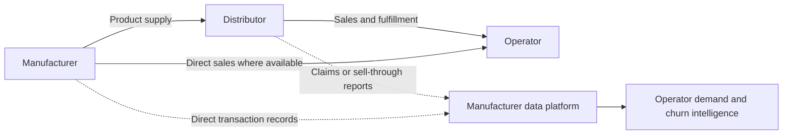
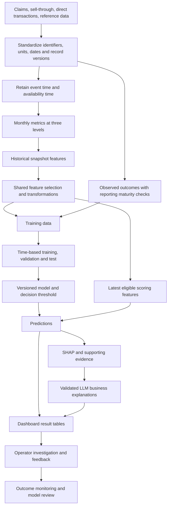
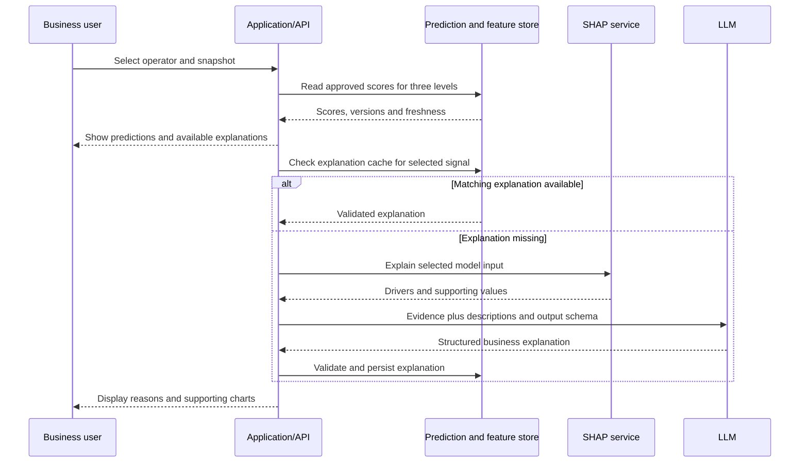

# Manufacturer Churn Intelligence: Reusable Solution Blueprint

Version: 1.0 | Prepared: 2026-10-03 | Perspective: manufacturer

This document standardizes the process developed in the claims-based prototype so another B2B manufacturer can adopt it with its own data, product structure, buying patterns, and operating rules. It covers the business definition, source data, analytical tables, features, labels, modeling, scoring, explanations, dashboards, and ongoing operation.

**The outcome is an evidence-backed view of operator demand risk across three levels: operator, operator + product line, and operator + product.** Claims inactivity is an observable signal; it does not establish that an operator has permanently left the manufacturer.

The prototype demonstrates the workflow using the available columns. It is not a complete enterprise data model or a verified production deployment. This blueprint distinguishes **implemented behavior**, **experiment results reported during development**, and the **standard to implement for reuse**.

## Contents

1. [Business Scope](#1-business-scope)
2. [Prototype Evidence And Status](#2-prototype-evidence-and-status)
3. [End-To-End Process](#3-end-to-end-process)
4. [Source Data Contract](#4-source-data-contract)
5. [Standard Data Foundation](#5-standard-data-foundation)
6. [Time And Data Availability](#6-time-and-data-availability)
7. [The Three Analytical Tables](#7-the-three-analytical-tables)
8. [Feature Engineering](#8-feature-engineering)
9. [Labels And Eligibility](#9-labels-and-eligibility)
10. [Training And Evaluation](#10-training-and-evaluation)
11. [Model Selection And Tuning](#11-model-selection-and-tuning)
12. [Scoring And Result Contracts](#12-scoring-and-result-contracts)
13. [SHAP Explanations](#13-shap-explanations)
14. [LLM Business Explanations](#14-llm-business-explanations)
15. [Dashboard Requirements](#15-dashboard-requirements)
16. [Pipeline And Production Operation](#16-pipeline-and-production-operation)
17. [Prototype Gaps To Resolve](#17-prototype-gaps-to-resolve)
18. [Onboarding Another Manufacturer](#18-onboarding-another-manufacturer)
19. [Repository Reference](#19-repository-reference)

## 1. Business Scope

### 1.1 Whose problem this solves

A manufacturer needs to understand whether operators are reducing purchases of its products, where the decline starts, and what observable changes support that concern. An operator may buy through distributors, direct channels, buying groups, or pricing programs. The manufacturer may receive downstream evidence through claims, billbacks, sell-through reports, or invoices.

Use **operator** consistently for the purchasing end-user business. Distributor and agreement identifiers can provide transaction context, but they do not introduce additional prediction levels in this solution.



### 1.2 The three supported levels

| Prediction level | One snapshot represents | Business question | Meaning of next-month inactivity |
|---|---|---|---|
| Operator | One operator across the manufacturer's observed products | Is the overall observed relationship weakening? | No qualifying activity for that operator |
| Operator + product line | One operator within one product line | Is the operator stopping purchases in a particular line? | No qualifying activity in that operator-line relationship |
| Operator + product | One operator purchasing one product/SKU | Is a specific item relationship weakening? | No qualifying activity in that operator-product relationship |

There are no standalone distributor, agreement, location, or product-only churn models in this scope. Product-level risk here always means **an operator's relationship with a product**. Commercial ownership can be used to route a case without becoming a modeling level.

Example: an operator stops buying one SKU but purchases another SKU in the same line. The product signal may be elevated while the line and overall operator remain active. That is a possible substitution pattern, not sufficient evidence of total operator churn. A product replacement mapping is needed to substantiate substitution.

### 1.3 Decisions the solution supports

| Decision | Evidence the solution should provide |
|---|---|
| Which operators deserve attention? | Risk, recent activity, relationship value, and data freshness |
| Where is demand weakening? | Operator, line, and product signals side by side |
| What changed before the signal? | Purchase, volume, price, breadth, and reporting trends |
| Could this be a reporting problem? | Feed coverage, known reporting delays, and missing-data status |
| Who should review the relationship? | Existing account ownership or a configured team mapping |
| Did intervention help? | Follow-up outcomes and subsequent matured purchase activity |

The system supports investigation and commercial judgment. It does not prove competitor conversion, set negotiated prices, or attribute a business cause that the source data cannot establish.

## 2. Prototype Evidence And Status

This blueprint was grounded in the local SQL, the operator SHAP/LLM notebook, the dashboard files, the source sample supplied during development, and the reported evaluation results. No live BigQuery tables were queried while writing it.

| Area | What is evidenced in this project |
|---|---|
| Source | SQL reads `pricing-lighthouse.claims_6m_data.claims_trans`; a source sample was supplied in the conversation, but no full local source extract or original source-building pipeline is available |
| Monthly tables | Three SQL pipelines create monthly metrics, snapshot features, and training data at the supported levels |
| Time axis | Current monthly SQL groups by `delivery_date`; `claim_date` supplies reporting context |
| BQML | Baseline models exist for all three levels; additional operator model experiments exist |
| Curated operator experiment | Separate table and regularized depth-5 model, with a modified feature set |
| CatBoost and LightGBM | Notebook experiments and results were discussed and reported; the Python training files referenced by older documentation are not present in this checkout |
| Explainability | SQL explanation scripts exist for the three levels; the richer LLM notebook targets the curated operator model |
| Metadata | Operator monthly, snapshot, training, and curated tables have explicit schemas with descriptions; the other two levels do not yet have equivalent explicit schemas |
| Dashboard | `dashboard/` is a static demonstration with simulated updates; the notebook includes a Dash example |
| Production operations | Automated deployment, live API integration, production monitoring, and release controls are proposed requirements, not verified completed components |

The current SQL is the reference for implementation details. Older handoff text and README claims such as "no future leakage" require the qualifications in this document, particularly around late-arriving records.

## 3. End-To-End Process



| Stage | Deliverable | Required check before proceeding |
|---|---|---|
| Define the use case | Written target, population, horizon, and operational decision | Business meaning and observation limits are agreed |
| Map sources | Source-to-canonical mapping and gap register | Each required field has a known meaning and owner |
| Prepare data | Deduplicated, normalized, versioned records | Totals reconcile and identifiers resolve |
| Build monthly metrics | Complete entity-month timelines | Unique keys, gap handling, and source coverage are correct |
| Build features | Versioned historical feature snapshots | Every input was available at its scoring cutoff |
| Build labels | Mature outcomes and eligibility reasons | Missing future evidence is not labeled as churn |
| Develop models | Reproducible experiments | Selection uses chronological validation |
| Release scoring | Approved model, threshold, and feature contract | Latest scoring path matches the training transformation |
| Explain | SHAP plus validated business narrative | Class direction and supporting facts agree |
| Serve and monitor | Dashboard data and review workflow | Freshness, versions, feedback, and failures are visible |

## 4. Source Data Contract

### 4.1 What the prototype source looks like

The supplied `claims_trans` sample is a flat claims-activity table. It contains identifiers, commercial amounts, period fields, and derived dates. It should not automatically be described as one invoice or one order per row. The visible schema does not establish invoice/header/line relationships, and the SQL uses `COUNT(*)` as its transaction count.

The displayed `Row` field in the sample is a result-grid row number, not an assumed business column.

| Source fields | Meaning / proposed canonical mapping | Current use and qualification |
|---|---|---|
| `id` | Source record identifier | Available in the sample; monthly SQL does not use it to deduplicate |
| `operator` | `operator_id` | Entity identifier used by all three pipelines |
| `product` | `product_id` | Product/SKU identifier; required for operator-product rows |
| `prod_line` | `product_line_id` | Grouping used by line models and product breadth features |
| `prod_h_1`, `prod_h_2`, `prod_h_3` | Raw product hierarchy components | Present in the sample; not separate predictors in the current pipelines |
| `opr_distr` | Reporting distributor identifier | Available context; not a separate prediction level and not used by current monthly feature SQL |
| `opr_agreement` | Pricing-program/agreement identifier | Counts and concentration features; does not establish terms, expiry dates, or renewal status |
| `opr_div` | Manufacturer division code | Available context; not used as a dedicated model level |
| `sales_territory` | Territory identifier | Counts and concentration features in existing SQL; not a separate model level |
| `delivery_date` | `activity_date` | Current feature and outcome event date; verify whether it is a real date or a month placeholder |
| `claim_date` | `reported_date` | Reporting-date proxy; not proof of when the analytics platform first received a record |
| `fy_period`, `fisc_period`, `cal_year`, `cal_month` | Source calendar/fiscal context | Retain for reconciliation; do not assume fiscal and calendar periods are interchangeable |
| `opr_qty`, `opr_unit` | Quantity and unit of measure | Quantity is summed; current SQL does not normalize mixed units |
| `opr_revenue`, `currency` | Observed transaction revenue and currency | Revenue is summed; current SQL does not convert currencies |
| `agreement_price` | Observed or derived unit price | Averaged and used in discount calculations |
| `list_price` | Reference list price or prototype proxy | Used for gross-list revenue and discounts; validate provenance before business interpretation |
| `claim_amount` | Claim/billback amount or prototype proxy | Used for claim totals and ratios; verify what it represents |
| `min_month_price`, `max_month_price` | Derived monthly price bounds | Present in the sample; excluded as explicit feature inputs by the current feature pipelines |

The development history described `agreement_price = revenue / quantity`, `list_price = 1.25 * max_month_price`, and `claim_amount = (list_price - agreement_price) * quantity`. Those are **reported prototype derivations**, not verified source-system facts or universal manufacturer rules. Actual list prices and actual billback amounts should replace these proxies when supplied. Their dependencies also need historical availability checks.

### 4.2 Minimum and additional data

| Requirement | Why needed | Handling when unavailable |
|---|---|---|
| Stable operator identity | Distinguish inactivity from an identifier change | Establish a mapping; otherwise report identity uncertainty |
| Stable product identity and product-line mapping | Build consistent product and line histories | Limit supported levels or reconcile an unknown-product bucket |
| Activity date or reliable activity month | Assign purchases to an outcome period | Use month-based features if day precision is unavailable |
| Explicit activity/record eligibility rule | Decide what counts as a purchase | Document the proxy, such as accepted claim rows |
| Record identity and update semantics | Prevent duplicated or reversed sales | Use a verified composite key if the source lacks a stable line ID |
| Availability timestamp and retained versions | Reconstruct historical knowledge | Restrict claims of point-in-time evaluation; start preserving versions |
| Feed coverage and completeness information | Separate missing files from inactivity | Mark unverified periods as incomplete rather than confirmed zero |
| Revenue, currency, quantity, unit | Create value and volume features | Normalize or omit incompatible measures; do not silently combine units |
| Actual invoice/order identifiers | Measure purchase occasions | Keep claim-row counts labeled as row-count proxies |
| Effective-dated price/list-price/cost data | Interpret discounts and economics | Omit unavailable economics or label estimates explicitly |
| Returns, credits, cancellations, claim status | Separate activity from accounting adjustments | Track adjustments separately and agree purchase eligibility |
| Product lifecycle/substitution mapping | Interpret discontinued or replaced items | Do not describe product inactivity as confirmed competitive loss |
| Operator profile and commercial ownership | Segment and route investigations | Support ID-based exploration without invented operator attributes |
| Service events and engagement records | Investigate service and relationship changes | Exclude unsupported explanations |

An inactivity model can be prototyped with limited fields. Reliable historical evaluation additionally requires availability and outcome completeness. More columns are useful only when their meaning, timing, and coverage are trustworthy.

## 5. Standard Data Foundation

### 5.1 Canonical tables

These are recommended reusable contracts, not tables already created by the prototype.

| Table | Grain / key | Essential content |
|---|---|---|
| `raw_activity_versions` | Source record + source version | Original payload, source system, file ID, ingestion time, change type |
| `dim_operator` | Canonical operator + validity interval | Operator identifiers, names, optional business profile, mapping provenance |
| `operator_identity_map` | Source system + source operator + validity interval | Canonical operator, match status, mapping availability |
| `dim_product` | Product + validity interval | Product line, description, unit conversions, lifecycle where available |
| `fact_activity_line_versions` | Canonical activity record + version | Operator, product, event time, availability time, normalized measures, eligibility and reversal status |
| `fact_claim_header` | Claim ID + version, if headers exist | Reporting source, submission/receipt timing, processing status |
| `product_price_cost_history` | Product + applicable commercial keys + validity interval | Actual list price/cost, currency, unit, effective dates, availability |
| `feed_completeness` | Source feed + activity period + assessment version | Expected/received files, coverage, freshness, mature-through date |
| `feature_dictionary` | Feature name + grain + definition version | Business description, formula, unit, null policy, time boundary, provenance |
| `model_registry` | Grain + model version | Feature manifest, training data version, parameters, metrics, threshold, status |

Use `manufacturer_id` in keys when hosting multiple manufacturers. In an isolated deployment it can remain a configured scope. Never let one manufacturer's peer totals or records enter another's features.

Claims, direct invoices, and sell-through files may overlap. Define precedence and cross-source transaction matching before adding their revenue together. Manufacturer shipments into a distributor are not interchangeable with observed sales to an operator.

### 5.2 Standardization rules

| Topic | Required rule |
|---|---|
| Identifiers | Treat codes as identifiers; preserve leading zeros and source namespace where needed |
| Duplicates and corrections | Select the valid record version as of the requested cutoff; retain the original history |
| Returns and negatives | Separate purchases, credits, and reversals; do not universally drop all negative revenue |
| Currency | Convert using an approved dated rate or model separately; retain original amounts |
| Units | Normalize with product-specific conversions; do not add cases, individual items, and kilograms as one comparable quantity |
| Missing amounts | Keep missingness indicators; distinguish absent measures from a known zero |
| Dates | Reconcile fiscal and calendar definitions; validate reporting before delivery instead of silently treating it as zero delay |
| Product-line mapping | Resolve one applicable line per product event; retain mapping versions for historical reproducibility |
| Reference joins | Ensure one applicable reference record per activity row; assert revenue is unchanged by the join |
| Monetary precision | Retain sufficient calculation precision; apply two-decimal business formatting at presentation |

For monthly cost data, `product_id + delivery_month` is sufficient only if the source guarantees one applicable cost record for that key. Add currency, unit, commercial scope, and effective/availability conditions when necessary. Observed downstream revenue is not automatically the manufacturer's booked revenue or gross margin.

## 6. Time And Data Availability

### 6.1 Keep these clocks separate

| Field / concept | Meaning |
|---|---|
| `activity_date` | When the purchase/delivery happened |
| `reported_date` | When a distributor submitted or dated the claim |
| `available_at` | When that record version was usable by the prediction system |
| `snapshot_month` | Business month represented by the feature row, usually stored as its first day |
| `feature_as_of_at` | Knowledge cutoff for that feature snapshot |
| `scored_at` | When inference actually ran |
| `outcome_start` / `outcome_end` | Future interval whose activity defines the label |
| `label_mature_at` | Earliest time the outcome is accepted as sufficiently observed |

The current `snapshot_month = 2015-05-01` row describes activity through the end of May. It is not a prediction made on May 1 using the rest of May in advance. For a next-calendar-month model, the corresponding outcome is June.

### 6.2 Point-in-time feature rule

For a prediction cutoff `T`, use only record versions available by `T`, and restrict activity to the feature's lookback interval. Apply the same rule to identity mappings, product attributes, prices, peer totals, and all joined sources.

```text
Eligible feature evidence:
    activity_date is inside the feature window
    AND available_at <= feature_as_of_at
    AND this is the applicable record version at that cutoff
```

Example: a March delivery first received in May cannot appear in the March-end historical feature snapshot. It may enter a later snapshot's historical lookback when it becomes known. Rebuilding March today from all currently available claims would otherwise change what the model appears to have known in March.

If only a month-level claim date exists, do not infer an exact receipt day. Preserve that uncertainty and avoid claiming precise day-level reporting-delay features.

**Current implementation gap:** monthly revenue, quantity, counts, breadth, and peer aggregates use every qualifying source row grouped by delivery month. Only selected reporting-delay calculations check `claim_date <= LAST_DAY(snapshot_month)`. Consequently, historical feature windows can look backward in event time while still containing records that arrived later. A backward SQL window alone does not establish leakage safety.

### 6.3 Monthly aggregates and historical knowledge

For production, choose and document one historical reconstruction method:

| Method | Behavior | Consequence |
|---|---|---|
| Recompute lookbacks as of each prediction cutoff | Aggregate event-month values using all versions known at that cutoff | Captures late claims known by the current cutoff; requires availability-aware history |
| Freeze month-end observed metrics | Retain what was known at each original month end | Simpler historical features, but later-arriving claims need separate features and totals remain "as observed then" |

Do not combine restated historical monthly totals with frozen historical predictions without identifying the revision. Preserve the exact feature row used for every issued score. For as-of recomputation, outcomes should be built separately from matured activity rather than inferred from a future feature row with a different completeness state.

### 6.4 Reporting completion and label maturity

The existing `reporting_completion_rate_1m` divides claims reported by delivery-month end by the total claim rows currently assigned to that delivery month. That denominator can contain future-arriving claims. The final completion rate is therefore a useful retrospective diagnostic, but is not necessarily knowable at the original cutoff.

Production alternatives include receipt counts known at cutoff, days since the latest received file, expected-versus-received feed coverage, and delay distributions estimated from older matured cohorts. Estimated completeness must be labeled as an estimate; a denominator containing later claims must not enter an earlier feature snapshot.

Likewise, a June delivery month appearing in the source does not prove June reporting is complete. A May snapshot label based on June must remain provisional or unknown until June's reporting meets the maturity policy. Derive that policy from observed delays and source commitments, rather than assuming a fixed universal delay.

If scoring occurs after the next month has begun, state whether the task is a month-end forecast, a remaining-period forecast, or a partial-month nowcast. Allowing late data into the features while retaining an already-started target changes the task and must be reflected in evaluation.

## 7. The Three Analytical Tables

### 7.1 Responsibilities

| Layer | Question it answers | Contains | Used by |
|---|---|---|---|
| Monthly metrics | What activity was observed in this month at this level? | Aggregated amounts, counts, breadth, reporting metrics, activity flag, peer context | Analytics and feature engineering |
| Snapshot features | What does the history through this cutoff tell us? | Monthly metrics, lags, rolling windows, changes, recency, volatility, lifetime-to-date features | Model training and inference |
| Churn training | What happened after each eligible historical snapshot? | Snapshot features, target, outcome helpers, split metadata | Historical model development and evaluation |

All three layers use the same entity grain within their pipeline. The training table has fewer months because not every feature snapshot has an observable future outcome. Live inference must not depend on having a known target.

### 7.2 Actual prototype table names

All nine tables below are in `pricing-lighthouse.claims_6m_data`.

| Level | Monthly metrics | Snapshot features | Training |
|---|---|---|---|
| Operator | `operator_monthly_metrics` | `operator_snapshot_features` | `operator_churn_training` |
| Operator + product line | `operator_product_line_monthly_metrics` | `operator_product_line_snapshot_features` | `operator_product_line_churn_training` |
| Operator + product | `operator_product_monthly_metrics` | `operator_product_snapshot_features` | `operator_product_churn_training` |

### 7.3 Verified column counts

These counts were checked against the current SQL, not a live warehouse schema. They are implementation inventory, not a recommended feature-count target.

| Level | Monthly columns | Snapshot columns | Snapshot identifiers/date helpers | Baseline predictor columns | Training columns including label/helpers/split |
|---|---:|---:|---:|---:|---:|
| Operator | 40 | 209 | 4 | 205 | 214 |
| Operator + product line | 39 | 202 | 5 | 197 | 207 |
| Operator + product | 38 | 192 | 6 | 186 | 197 |

Each training table adds five columns: `future_active_months_next_1m`, `future_revenue_next_1m`, `churn_next_1m`, `churn_label`, and `dataset_split`. Only `churn_label` is the target; none of those five is a predictor.

The operator experiment `operator_churn_curated_training` contains **228 columns**. It adds 14 columns to the 214-column training table. Its current model excludes 20 columns and uses one target, leaving **207 predictors**. "Curated" denotes a changed feature selection, not necessarily fewer inputs than the 205-predictor baseline.

### 7.4 Building monthly metrics

1. Select valid, in-scope activity at the intended knowledge cutoff.
2. Resolve operator/product identities and applicable product line.
3. Derive the business activity month.
4. Aggregate at the relevant entity-month key.
5. Create a continuous calendar from the entity's first known activity through the selected snapshot month.
6. Join activity to that calendar and distinguish observed inactivity from missing coverage.
7. Add peer totals and concentration measures with the same cutoff and scope.
8. Validate key uniqueness, totals, row counts, and descriptions before publishing.

The prototype fills absent months with zero activity after first purchase through the source's maximum month. The production standard permits zero filling only where observation coverage supports it. A missing report or unavailable source is an unknown period, not evidence of no purchases.

Dense calendars are essential: `LAG(..., 1)` means the previous row, and `ROWS BETWEEN 2 PRECEDING AND CURRENT ROW` means three rows. They mean consecutive months only when each entity has one row per calendar month.

Create timelines for observed operator-line and operator-product relationships, not the Cartesian product of every operator and every SKU. Higher-grain detail naturally produces more rows because one operator can have many such relationships.

**Product key requirement:** current product monthly SQL groups by `operator, product, prod_line, snapshot_month`, while later windows partition by `operator, product`. Reuse requires a consistent product-line mapping or an explicit historical mapping strategy so there is still exactly one operator-product row per month.

### 7.5 Row reconciliation

| Comparison | Expected relationship |
|---|---|
| Monthly versus snapshot features | Usually the same entity-month rows; any loss must be explained by explicit eligibility rules |
| Snapshot versus training | Training excludes immature/unavailable outcomes and any configured ineligible population |
| Operator versus operator-line/product | Different grains; higher row counts at detailed levels are expected |
| Revenue across levels | Totals reconcile after accounting for rejected or unmapped products/lines and consistent source scope |

Development outputs reported 55,466 operator-product feature rows and 46,958 training rows, with the 8,508 June rows excluded. Those are historical reported results, not row counts verified here or constants for another manufacturer.

### 7.6 Worked example through the three layers

The following values are illustrative. Assume one operator, complete reporting through April, no late records, and a feature cutoff at each month end. March is a known inactive month. May outcomes are unavailable.

| Monthly metrics: snapshot | `revenue_1m` | `transactions_1m` | `is_active_1m` |
|---|---:|---:|---:|
| January | 1000.00 | 10 | 1 |
| February | 800.00 | 8 | 1 |
| March | 0.00 | 0 | 0 |
| April | 600.00 | 6 | 1 |

| Snapshot features: snapshot | `prev_revenue_1m` | `revenue_2m` | `months_since_last_purchase` | `lifetime_revenue` |
|---|---:|---:|---:|---:|
| January | NULL | 1000.00 | 0 | 1000.00 |
| February | 1000.00 | 1800.00 | 0 | 1800.00 |
| March | 800.00 | 800.00 | 1 | 1800.00 |
| April | 0.00 | 600.00 | 0 | 2400.00 |

January's two-month total has only one observed month, so its history coverage must be identified. The training layer retains these features and adds the next-month outcome: January has label `0`, February has label `1`, and March has label `0`. April remains available for scoring but has no training label yet. February's positive label describes March inactivity even though purchases resume in April; it does not establish permanent loss.

The same sequence applies to an operator-line or operator-product pair using only that relationship's activity. Actual training inclusion also depends on the chosen population and label maturity rules.

## 8. Feature Engineering

### 8.1 Common calculation, different meaning by grain

| Feature concept | Operator | Operator + product line | Operator + product |
|---|---|---|---|
| `revenue_1m` | Revenue across the operator's observed products | Revenue within that line for that operator | Revenue for that operator-SKU pair |
| `transactions_1m` | Claim/activity rows across the operator | Rows within the operator-line pair | Rows within the operator-product pair |
| Recency and activity | Overall operator buying history | Buying history for the specific line | Buying history for the specific SKU |
| Lags / rolling / trends | Computed within operator | Computed within operator + line | Computed within operator + product |
| Product breadth | Distinct products and distinct product lines | Distinct products within the line | Not useful as an own-SKU breadth count |
| Product concentration | Top product and top product-line revenue shares | Top-product revenue share within the line | No own-product concentration feature |
| Peer revenue share | Operator revenue / observed portfolio revenue | Pair revenue / observed revenue for that line | Pair revenue / observed revenue for that product |
| Revenue rank | Across operators in the month | Across operators buying/observed in the line | Across operators buying/observed for the product |
| Lifetime-to-date | Observed history of operator | Observed history of operator-line relationship | Observed history of operator-product relationship |

Current "market" fields describe the **observable manufacturer dataset**, not total industry market share or the operator's share of wallet across competitors. Label them "share of observed portfolio revenue" or the corresponding line/product label in business displays.

### 8.2 Feature families and business purpose

| Family | Existing examples | Calculation / interpretation | Why useful and limitation |
|---|---|---|---|
| Current activity | `revenue_1m`, `quantity_1m`, `transactions_1m` | Sum amounts and count rows in snapshot month | Measures latest scale; a row count is not necessarily order frequency |
| Recency | `months_since_last_purchase`, `inactive_month_streak` | Months since the latest observed active month | Detects inactivity; can be distorted by missing reports |
| Tenure/history | `months_since_first_purchase`, `months_observed_to_date` | Time since first observed activity and available monthly rows | Distinguishes short history; does not establish true relationship start |
| Purchase continuity | `active_months_2m`, `active_months_3m`, `active_months_6m` | Count months with eligible activity | Indicates buying regularity |
| Breadth | `unique_products_1m`, `unique_product_lines_1m`, rolling averages | Distinct IDs this month or average monthly distinct counts | Assortment narrowing can accompany erosion |
| Price/unit economics | `avg_price_1m`, `revenue_per_unit_3m` | Mean row price or total revenue / total quantity | These are different measures; mixes and units affect interpretation |
| Discount/reference economics | `gross_list_revenue_1m`, `discount_pct_3m` | List-value total and discount / list-value total | Useful only with a valid reference-price definition |
| Claim intensity | `claim_amount_1m`, `claim_to_revenue_3m` | Claim total and claim / revenue ratio | Describes billback exposure, not automatically service complaints |
| Reporting | `avg_claim_report_delay_days_1m`, `reporting_completion_rate_1m` | Delay and reporting ratio | Needs the availability/completeness corrections in Section 6 |
| Concentration | `top_product_revenue_share_1m`, `top_product_line_revenue_share_1m` | Largest component revenue / covered total | Indicates dependence on a narrow assortment |
| Commercial context | `unique_agreements_1m`, `top_agreement_revenue_share_1m`, territory equivalents | Counts and revenue shares of source identifiers | Existing optional predictors, not standalone model levels or evidence of contract expiry |
| Relative position | Share, revenue rank, percentile | Position within the observed peer group at cutoff | Helps compare entities; sensitive to changing feed coverage |
| Lags | `prev_revenue_1m`, `revenue_lag_2m`, `revenue_lag_3m` | Values at prior months | Supplies prior behavior explicitly |
| Momentum | `revenue_mom_pct`, `transactions_mom_change` | Current minus previous, optionally divided by previous | Highlights recent decline or recovery |
| Multi-month trends | `quantity_trend_3m_change`, `revenue_trend_4m_slope` | Endpoint changes and change per month | Summarizes direction; not proof every month moved consistently |
| Acceleration | `revenue_mom_acceleration` | Current change minus previous change | Indicates whether movement is intensifying |
| Rolling levels | `revenue_2m`, `revenue_3m`, `revenue_6m` | Sums including current month | Smooths noise and describes recent relationship size |
| Volatility | `revenue_stddev_3m`, `quantity_cv_6m`, `price_cv_6m` | Population standard deviation; CV = standard deviation / mean | Describes instability; unstable around near-zero means |
| Recent versus earlier | `revenue_3m_vs_prior_3m_pct` | Latest three months versus the preceding three | Detects decline relative to a separate baseline |
| Lifetime-to-date | `lifetime_revenue`, `lifetime_avg_monthly_revenue`, `lifetime_max_monthly_revenue` | Cumulative/average/max observed through cutoff | Context for value and unusual decline; not a full lifetime if history is truncated |
| Calendar | `month_sin`, `month_cos` | Sine/cosine of calendar month angle | Encodes annual position; short history cannot validate an annual seasonal pattern |
| Data quality | `missing_revenue_rows_1m`, `missing_price_rows_1m` | Counts of missing source values | Helps identify unreliable inputs and monitor data changes |

Detailed current feature lists remain in the three pipeline READMEs linked in Section 19. The reusable dictionary must describe the actual formula, not just infer a description from a column name.

### 8.3 Window definitions

Let `t` be the snapshot month and `r(t)` the revenue known under that snapshot's availability policy.

| Feature/window | Definition |
|---|---|
| `revenue_1m` | `r(t)` |
| `prev_revenue_1m` | `r(t-1)` |
| `revenue_2m` | `r(t) + r(t-1)` |
| `revenue_3m` | Sum from `t-2` through `t` |
| `revenue_6m` | Sum from `t-5` through `t` |
| `revenue_prior_3m` | Sum from `t-5` through `t-3` |
| `revenue_mom_change` | `r(t) - r(t-1)` |
| `revenue_mom_pct` | `(r(t) - r(t-1)) / r(t-1)` when the denominator is valid |
| `revenue_trend_3m_slope` | `(r(t) - r(t-2)) / 2` |
| `revenue_mom_acceleration` | `r(t) - 2*r(t-1) + r(t-2)` |
| `lifetime_revenue` | Sum of known observed history through `t` |

A monthly snapshot cadence and a 12-month history window are separate choices. A manufacturer can use monthly snapshots with 60-day, 90-day, 180-day, and 365-day features if true activity dates support them. Exact days require date-based filtering; two calendar months are not exactly 60 days, and three calendar months are not exactly 90 days. The existing scripts implement calendar-month windows, not exact-day windows or 12-month rolling features.

Early snapshots may contain less history than the window name suggests. Record available history per window; either require a full window, use a documented partial-window calculation, or provide coverage flags. The existing fixed denominators in `activity_rate_6m = active_months_6m / 6` can make a newly observed operator appear less active simply because six months are not yet available.

`AVG(unique_products_1m)` is average monthly breadth, not the number of distinct products across the entire lookback. Similarly, averaging monthly prices or completion ratios gives equal weight to months; use explicit numerator/denominator totals if a weighted measure is intended.

### 8.4 Curated operator experiment

The current curated experiment adds these columns:

| Added columns | Purpose |
|---|---|
| `prev_revenue_percentile_in_month`, `prev_market_revenue_share_1m`, `prev_market_quantity_share_1m`, `prev_revenue_rank_in_month` | Prior-month peer-position helpers |
| `revenue_percentile_mom_change`, `market_revenue_share_mom_change`, `market_quantity_share_mom_change`, `revenue_rank_mom_improvement` | Movement in peer position |
| `revenue_vs_lifetime_avg_pct`, `quantity_vs_lifetime_avg_pct` | Relative difference from the observed lifetime-to-date average |
| `revenue_drop_from_lifetime_peak_pct`, `quantity_drop_from_lifetime_peak_pct` | Relative shortfall from the observed historical maximum |
| `is_below_lifetime_avg_revenue`, `is_below_lifetime_avg_quantity` | Flags for below-average activity |

The average and peak include the current snapshot in this implementation. If a strictly prior-history baseline is desired, use a separate prior-only definition and a new feature version.

The curated model excludes the ordinary identifier/label-helper columns plus `snapshot_quarter`, `snapshot_month_number`, three zero-activity flags, two reported-claim counts, current and previous revenue rank, and three raw peer totals. It retains relative movement features. This is an experiment choice, not a universal exclusion list for all manufacturers.

### 8.5 Selecting a reusable feature set

Begin with well-defined recency, activity, breadth, trends, and history coverage. Add pricing, reporting, or optional commercial features only when the data supports them. Min/max monthly price and separate raw `prod_h_1/2/3` predictors are not required; the configured product-line dimension supplies the grouping.

Remove deterministic duplicates and test feature families through validation ablations. Examples in the current calculations include a window total and its fixed-denominator average, a trend change and the same change divided by a constant, and overlapping recency/inactivity flags. Low global attribution alone is insufficient to prove a feature is unnecessary; correlated predictors may share importance.

Use an explicit versioned feature allowlist. Current `SELECT * EXCEPT (...)` statements can silently admit a new column. The same names, types, null handling, calculations, and selection must serve training, prediction, and SHAP.

The prototype rounds many measures, quantities, ratios, and shares to two decimals. For reuse, preserve calculation precision and format business displays to two decimals. Tiny shares, fractional quantities, model probabilities, and SHAP values can lose useful information when rounded before computation or thresholding. Any precision change requires a new feature version and reevaluation.

## 9. Labels And Eligibility

### 9.1 Implemented one-month target

For each eligible entity at month `t`:

```text
churn_label = 1  when no qualifying activity is observed during t+1
churn_label = 0  when qualifying activity is observed during t+1
churn_label = NULL when that outcome is not sufficiently observable
```

The same definition is applied independently at the operator, operator-line, and operator-product grains. The prototype copies `churn_next_1m` into `churn_label` and retains the future active-month and revenue fields for auditing. It currently defines activity as at least one source row, even if amounts are zero. Production eligibility must determine which accepted purchases, claims, credits, or adjustments count.

### 9.2 Inactivity versus a new churn event

The current training SQL includes all post-first-purchase months with a future month. It does not require the entity to be active or recently active at `t`. An already dormant entity can therefore receive repeated positive labels. The implemented task is **next-month observed inactivity**, not strictly the first transition into churn.

For each manufacturer, choose the intended population:

| Population policy | Meaning | Application |
|---|---|---|
| All observed relationships | Predict inactivity for active and dormant entities | Broad monitoring; display dormant state separately |
| Recently active relationships | Predict loss of activity among entities active within an agreed lookback | Retention prioritization |
| Currently active relationships | Predict transition from activity at `t` to inactivity at `t+1` | New inactivity event prediction |

Record the policy and apply it consistently in training and scoring. Do not train on long-dormant entities and present the result as performance only on actively buying operators.

### 9.3 Label maturity and exclusions

Store `label_status` such as `MATURE`, `PENDING`, or `INSUFFICIENT_COVERAGE`, with an exclusion reason. Do not coalesce missing future rows into confirmed inactivity unless the complete entity calendar and feed coverage justify it.

The prototype excludes the final source month because there is no next month. Production also excludes outcomes still subject to material reporting lag. Label finalization may therefore trail the latest feature snapshot by more than one month.

For infrequently purchased products, one inactive month may be normal. Validate the horizon against reorder cadence. Longer inactivity horizons or revenue-erosion targets are possible extensions, but require separate label versions and evaluation; they are not already implemented by these one-month scripts.

## 10. Training And Evaluation

### 10.1 Chronological split

The current scripts allocate ordered eligible snapshot months approximately 60% / 20% / 20%, using rounded-up month counts. This is a month-based split, not a random row split, and small month counts need explicit checks that all three splits exist.

The development data produced this schedule:

| Role | Feature snapshot months | Outcome months | Interpretation |
|---|---|---|---|
| TRAIN | November 2014 through March 2015 | December 2014 through April 2015 | Fit model parameters |
| VALIDATION | April 2015 | May 2015 | Select model, features, and threshold |
| TEST | May 2015 | June 2015 | Historical evaluation, subject to June reporting maturity |
| Unlabeled scoring | June 2015 | July 2015 | No evaluation without sufficiently observed July outcomes |

This is a description of the prototype, not a production schedule to copy. More snapshot months can exist than the nominal "six months" of claims reporting because deliveries may precede reporting periods.

### 10.2 Availability-aware backtesting

For each historical deployment cutoff:

1. Freeze the data and reference versions available at that time.
2. Select training examples whose labels had matured by that cutoff.
3. Fit preprocessing and the model using those training examples.
4. Score the next evaluation snapshot using its available feature data.
5. Evaluate later, after that snapshot's outcome matures.

Training label availability matters as much as feature availability. For example, a March snapshot's April inactivity label may not be known by the end of April when late claims are material. A realistic April-end forecast cannot train on that label just because April appears in a static extract.

Use several rolling historical cutoffs when history permits. A calendar gap or embargo should follow the outcome horizon and reporting maturity, not an arbitrary universal number. An operator appearing in multiple chronological splits is expected when forecasting existing relationships; a separate operator holdout answers a different question about new-operator generalization.

### 10.3 Predictor and metadata separation

| Column role | Examples | Training use |
|---|---|---|
| Entity/snapshot identifiers | `operator`, `product`, `prod_line`, `snapshot_month` | Retain for joins and reporting; current models exclude them as predictors |
| Date helpers | `first_purchase_month`, `last_purchase_month_to_date` | Derive tenure/recency; exclude raw helper dates |
| Target | `churn_label` | Pass as the sole label |
| Future audit helpers | `churn_next_1m`, `future_active_months_next_1m`, `future_revenue_next_1m` | Never predictors |
| Split/run metadata | `dataset_split`, proposed run/version fields | Never predictors |
| Approved behavioral features | Versioned feature manifest | Model input |

### 10.4 Metrics and threshold selection

| Measure | What it contributes |
|---|---|
| Precision | How many flagged relationships actually become inactive |
| Recall | How much observed inactivity is captured |
| F1 | A balance of precision and recall at a specific threshold |
| ROC AUC | Ranking separation across positive and negative outcomes |
| Average precision / PR AUC | Positive-class ranking performance; record which calculation is used |
| Log loss and calibration | Whether predicted probabilities correspond to observed frequencies |
| Precision/recall at review capacity | Usefulness when teams can review only a fixed number of operators |
| Month/cohort breakdowns | Stability across time, history length, relationship size, and data coverage |

Select thresholds on validation according to the operating objective, such as a minimum precision at a workable review volume. Freeze that choice before final test reporting. A classification threshold changes decisions, precision, recall, and F1; it does not improve probability calibration or ROC AUC.

The notebook's `0.30` threshold and `0.70` high-risk boundary are prototype settings. They are not validated universal cutoffs. Class weighting can help fitting but does not establish that scores are calibrated probabilities of real-world loss.

Compare against simple baselines, including always-inactive, always-active, and a recency rule. Report label prevalence beside metrics. In the reported operator test set, 1,090 of 1,522 rows were positive: predicting every row positive already yields about 0.83 F1. That helps explain why a very low threshold can look strong without providing useful prioritization.

### 10.5 Lessons from the reported experiments

| Observation from development | Standardization implication |
|---|---|
| Operator positive-label rate rose from 12.62% TRAIN to 27.63% VALIDATION and 71.62% TEST | Investigate reporting maturity, population composition, continued dormancy, and genuine drift before interpreting model quality |
| Product-line and product rates showed similar jumps | A shared data/window issue is plausible, but requires investigation rather than assumption |
| Depth-10 UI metrics matched training confusion counts | UI evaluation labels alone do not establish out-of-time performance |
| Deeper trees improved training much more than held-out performance | More depth is not sufficient evidence of improvement; compare identical held-out data and thresholds |
| Curated operator results reported validation F1 about 0.69 and test F1 about 0.64 at the default threshold | Useful prototype evidence, not production acceptance or a guarantee for another manufacturer |
| CatBoost/LightGBM results differed by metric and split | There is no demonstrated universal model winner |
| Multiple rounds examined the same test set | Treat that test as explored; obtain a later untouched holdout or prospective evaluation before claiming final performance |

These values are user-reported development results, not newly reproduced evaluations. A model promotion decision requires frozen artifacts and complete evaluation context.

## 11. Model Selection And Tuning

### 11.1 Model families and existing configuration

| Model family | Role in the process | Prototype evidence |
|---|---|---|
| Simple activity rule | Operational baseline | Recommended comparison; not the principal SQL model |
| Logistic regression | Interpretable statistical baseline | Operator comparison script |
| BQML boosted trees | Learn nonlinear tabular patterns | Baselines at all three levels, operator depths 3/4/5/8/10 and regularized experiments |
| Random forest | Alternative tree ensemble | Operator comparison script |
| CatBoost | Alternative tabular boosting | Operator notebook experiments reported during development |
| LightGBM | Alternative tabular boosting | Operator notebook experiments reported during development |

There is one pooled baseline model per grain, trained across eligible entities at that grain, rather than a separate model for every operator or SKU. The curated operator experiment does not automatically change the other two models.

| BQML parameter | Three-level baseline configuration | Curated operator configuration |
|---|---:|---:|
| `MODEL_TYPE` | `BOOSTED_TREE_CLASSIFIER` | `BOOSTED_TREE_CLASSIFIER` |
| `MAX_TREE_DEPTH` | 5 | 5 |
| `MAX_ITERATIONS` | 80 | 140 |
| `LEARN_RATE` | 0.05 | 0.025 |
| `L1_REG` | Not explicitly set | 0.2 |
| `L2_REG` | Not explicitly set | 5.0 |
| `MIN_TREE_CHILD_WEIGHT` | Not explicitly set | 8 |
| `SUBSAMPLE` | Not explicitly set | 0.8 |
| `AUTO_CLASS_WEIGHTS` | `TRUE` | `TRUE` |
| `DATA_SPLIT_METHOD` | `NO_SPLIT` | `NO_SPLIT` |
| `ENABLE_GLOBAL_EXPLAIN` | `TRUE` | `TRUE` |

These are reference experiment configurations, not parameter defaults to mandate for all manufacturers. Limiting depth is a complexity constraint; the scripts named "pruned" train shallower trees rather than performing a separate post-training pruning operation.

`NO_SPLIT` delegates no internal split to these BQML training statements. The `WHERE dataset_split = 'TRAIN'` clause determines which rows fit the model. The script evaluates VALIDATION and TEST separately, then uses `UNION ALL` to store the two labeled result rows together; it does not merge those rows into the fitting data.

The current scripts do not pass the external validation month to fitting as an early-stopping set. Do not describe them as validation-based early stopping. Python experiments should explicitly configure the chronological validation set, preserve preprocessing, and never use TEST as the early-stopping set.

Evaluation must specify the intended input rows and threshold. Without evaluation input, `ML.EVALUATE` returns metrics generated during training; these should not be confused with an independently supplied test set. See the [BigQuery ML evaluation reference](https://docs.cloud.google.com/bigquery/docs/reference/standard-sql/bigqueryml-syntax-evaluate).

### 11.2 Standard experiment procedure

1. Freeze an experiment dataset with its source version, feature manifest, population, label policy, and split months.
2. Establish simple and statistical baselines.
3. Compare a small set of depth, learning-rate, regularization, sampling, and iteration settings.
4. Test feature-family removals/additions on validation, including suspected reporting leakage and redundant variables.
5. Check monthly ranking, calibration, alert volume, and performance for low-history entities.
6. Choose the model and threshold using validation evidence and business review capacity.
7. Evaluate the locked candidate once on an untouched holdout, or report exploratory status if it was already inspected.
8. Register the model with its complete transformation and explanation contract.

Keep older experiments identifiable. Promote through a versioned production alias only after evaluation; a rerun should not erase the last working model's provenance.

## 12. Scoring And Result Contracts

### 12.1 Training and scoring share features

The standard path is:

```text
Snapshot features, including unlabeled latest months
    -> shared feature transformation
    -> approved model inputs
        -> join matured labels for training/evaluation
        -> select eligible snapshots for inference
```

Current baseline `05_score_latest...` scripts read snapshot feature tables. However, the curated operator explanation script and on-demand notebook read `operator_churn_curated_training`, which is built from already-labeled training rows. In the reported dataset this selects May, while the baseline feature table contains June. Their output is the latest **labeled historical** snapshot, not automatically the latest operational snapshot.

Before production, compute curated features for all eligible feature snapshots and join labels separately. Select the latest scoring period from a configured cutoff and coverage policy, not blindly from `MAX(snapshot_month)`.

### 12.2 Proposed durable result tables

| Table | Key / grain | Contents |
|---|---|---|
| `churn_predictions` | Manufacturer + entity grain/keys + snapshot + model version + run ID | Probability, threshold, decision, state, horizon, feature/data versions, timestamps |
| `churn_driver_attributions` | Prediction key + feature | Value, SHAP attribution, explained class, normalized direction, scale, rank |
| `churn_explanation_context` | Prediction key + context version | Curated evidence and feature descriptions supplied to the LLM |
| `churn_explanations` | Prediction key + prompt/schema/LLM versions | Structured reasons, caveats, evidence references, generation/validation status |
| `churn_model_evaluations` | Model version + evaluation period/split + threshold | Metrics, confusion counts, prevalence, sample counts, maturity status |
| `churn_feedback` | Prediction/case key + review event | Reviewer assessment, confirmed reporting issue, follow-up outcome |

Every prediction should retain `operator_id`, optional `product_line_id` and `product_id`, `snapshot_month`, `feature_as_of_at`, `outcome_start`, `outcome_end`, `model_version`, `feature_version`, `label_definition_version`, `threshold_version`, `data_version`, and `scored_at`.

Keep actual outcomes nullable until mature. Never label the latest score as "evaluated" merely because the prediction exists. Make unknown operators, new relationships, insufficient history, missing features, and stale data explicit result states.

### 12.3 On-demand path



Inference may reuse a current persisted score or run on the latest eligible feature row when needed. An on-demand request does not retrain a model or make monthly data real-time. Keep the dashboard responsive while explanations are pending.

## 13. SHAP Explanations

SHAP describes how feature values contribute to a model output relative to a baseline. For tree models, Tree SHAP computes those contributions efficiently. With all contributions in the same output space, the baseline plus contributions reconstructs the explained output. A contribution is an explanation of the model, not evidence that changing that feature would cause retention. See the [SHAP TreeExplainer reference](https://shap.readthedocs.io/en/latest/generated/shap.TreeExplainer.html).

The prototype uses `ML.EXPLAIN_PREDICT` for local explanations and `ML.GLOBAL_EXPLAIN` for overall importance. Global importance cannot explain the direction of risk for a specific operator.

### 13.1 Preserve class and scale

For BQML classification, `ML.EXPLAIN_PREDICT` returns attributions for the predicted class; `probability` belongs to that class. `prediction_value` is a raw logit rather than a percentage. `top_k_features` returns a subset ranked by absolute attribution, so that subset alone need not sum to the complete prediction. These semantics are documented in the [BigQuery explanation reference](https://docs.cloud.google.com/bigquery/docs/reference/standard-sql/bigqueryml-syntax-explain-predict).

Store the class actually explained before creating churn-direction labels:

| Explained class | Positive attribution | Negative attribution |
|---|---|---|
| Churn (`1`) | Supports churn | Opposes churn |
| Non-churn (`0`) | Supports non-churn; reduces churn direction | Opposes non-churn; increases churn direction |

The current notebook labels every positive attribution as increasing churn. That needs correction for rows explaining class `0`. Generate a consistent churn-class explanation where supported, or use the recorded explained class to normalize direction through a verified binary-class adapter. Retain the original attribution and output scale for audit.

Do not present a SHAP value of `0.14` as a 14-percentage-point probability increase. Do not treat `approximation_error = 0` as proof that the business prediction is correct; it concerns the explanation calculation.

### 13.2 Evidence needed per driver

| Field | Purpose |
|---|---|
| Feature name and business label | Connect model input to the business concept |
| Feature value and unit | Describe what was actually observed |
| Formula and time window | Explain the period represented |
| Comparison value / observed trend | Substantiate statements such as "purchases declined" |
| Raw attribution, class, and scale | Preserve model explanation semantics |
| Churn-relative direction | Drive consistent chart colors and narrative |
| Data-quality/completeness flag | Identify reporting uncertainty |
| Prediction/model/feature versions | Tie explanation to the exact score |

A high contribution from `transactions_1m` alone does not establish that transactions fell. The explanation needs the current value and an appropriate prior comparison before claiming a decline. Related revenue lags, sums, and changes should be grouped into one coherent business reason rather than repeated as independent evidence.

## 14. LLM Business Explanations

### 14.1 Role and input

The LLM translates verified evidence into concise business language. It does not calculate the churn score, infer missing contracts or competitor activity, or invent a root cause. This blueprint carries forward the requested business format: **three or four supported reasons, no raw numbers in the narrative, and no recommended actions**. If fewer distinct reasons are supported, return fewer with an evidence limitation instead of manufacturing reasons.

Provide the LLM with the prediction level and horizon, entity context, score/risk policy, class-normalized drivers, feature values, comparison values, descriptions, and reporting caveats. Numeric evidence can remain in the machine context even when it is omitted from the displayed prose.

The current notebook retrieves descriptions from BigQuery schema metadata using `INFORMATION_SCHEMA.COLUMN_FIELD_PATHS` and joins them to feature names. Its on-demand branch currently lacks feature values and comparison evidence in the driver context. Add those fields before permitting specific behavioral claims.

Maintain a versioned feature dictionary as the canonical description source and publish descriptions onto warehouse schemas. Do not assume descriptions propagate through every `CREATE TABLE AS SELECT` transformation. Description coverage and uniqueness must be checked for the feature version actually scored.

### 14.2 Structured response contract

Use a versioned schema and validate it in code before dashboard publication. An illustrative response shape follows; the text is an example, not a result generated for a real operator.

```json
{
  "schema_version": "1.0",
  "business_churn_reason_summary": "Recent buying patterns indicate elevated inactivity risk.",
  "operator_risk_narrative": "The observed relationship is weakening across recent purchase activity and assortment.",
  "evidence_quality": "limited",
  "risk_confidence_explanation": "Reporting uncertainty limits how confidently the observed change can be interpreted.",
  "likely_reasons": [
    {
      "reason_title": "Fewer purchase records",
      "reason_detail": "Recent recorded purchase activity is below the earlier pattern.",
      "risk_direction": "increases_risk",
      "business_theme": "purchase_activity",
      "evidence_ids": ["activity_comparison"]
    },
    {
      "reason_title": "Narrower assortment",
      "reason_detail": "The operator is purchasing a smaller range of products.",
      "risk_direction": "increases_risk",
      "business_theme": "product_mix",
      "evidence_ids": ["breadth_comparison"]
    },
    {
      "reason_title": "Incomplete reporting",
      "reason_detail": "Part of the apparent slowdown may reflect claims still being reported.",
      "risk_direction": "caution",
      "business_theme": "reporting_quality",
      "evidence_ids": ["feed_coverage_status"]
    }
  ],
  "caveats": ["These signals describe observed activity, not confirmed permanent loss."]
}
```

The service attaches authoritative entity IDs, dates, and model versions outside generated text. Define allowed keys, field types, reason-count limits, direction/theme enums, and evidence references in the response schema. Business labels should come from the governed dictionary; LLM-proposed label changes should not silently redefine metrics.

For a low-risk operator, describe protective or mixed evidence. Do not force an explanation of "why churn happened" when the output is a future risk prediction and no churn has been established.

### 14.3 Validation and failure handling

Validate transport status, JSON parsing, required field types, nonempty reasons, known evidence references, supported directions, and agreement with the supplied facts. Empty generation status does not establish that the output matches the expected schema. A parseable JSON array of strings also does not satisfy a required array of reason objects.

The observed `None`/`NULL` reason fields can arise from invalid JSON, wrong key names, wrong nesting, or wrong element types. Preserve the raw response and validation error; publish an explicit unavailable/pending state instead of a table of empty reason rows. Prompt instructions alone do not enforce a structured output contract.

### 14.4 Cost and concurrency

Generate narratives on demand, for prioritized cases, or when evidence materially changes. Cache by manufacturer, entity grain/keys, snapshot, feature/data version, model version, threshold/risk-policy version, context hash, prompt/schema version, and LLM version. Cache hits should avoid another model call.

The notebook's `CREATE OR REPLACE TABLE operator_churn_on_demand_*` flow overwrites a shared result for each request. Production requires request-scoped staging or keyed inserts/merges, retry control, and idempotency. Simultaneous operator requests must not replace each other's explanations.

Use a configurable supported LLM endpoint and connection. The model endpoint embedded in the prototype notebook is not a long-term interface contract. The LLM needs the selected evidence and dictionary, not unrestricted access to the entire warehouse.

## 15. Dashboard Requirements

### 15.1 Business views

| View | Required content | Interaction |
|---|---|---|
| Portfolio overview | Distinct monitored operators, flagged operators, risk distribution, exposure, source freshness | Filter snapshot and relevant business scope |
| Operator selector | Operator name/ID, observed state, last observed activity, history coverage | Search and open one operator |
| Operator overview | Overall risk, three-level signal summary, value/activity trends | Choose snapshot and inspect a signal |
| Product-line detail | Lines purchased, line risk, revenue/quantity trends, supported reasons | Drill into products within the selected line |
| Product detail | SKU-level risk, purchasing history, lifecycle context if available | Inspect a product relationship |
| Business explanation | Short summary and supported reasons, with reporting caveats | Request/refresh explanation and view evidence |
| Supporting analytics | Revenue, compatible-unit quantity, record counts, breadth, and risk over time | Compare periods without changing the score's evidence cutoff |
| Review status | Owner if available, reviewed/unreviewed status, business feedback | Record confirmed reporting issues or observed relationship changes |

Keep model-health diagnostics in a separate analyst/admin view. The main business experience should place the explanation where the user investigates drivers, consistent with the current dashboard direction.

### 15.2 Visual and semantic rules

Use time-series charts for behavior, a signed driver chart with a clearly stated explained class/scale, and a table for three-level signals. Numbers belong in labeled metrics and charts; the default LLM narrative remains plain-language and number-free.

Always show the snapshot, prediction horizon, data freshness, and whether outcomes are pending. Distinguish predicted inactivity, observed inactivity, insufficient data, and already-dormant state. A probability or risk band is not a separate statistical confidence measure.

Do not average independently trained product probabilities to create an operator probability. The operator model produces its own score. A count of risky products or the highest product score is a separate summary measure, with an explicit label.

### 15.3 Value and exposure

| Display | Standard definition |
|---|---|
| Flagged operator count | Distinct operators meeting the defined alert policy |
| Flagged relationship count | Count of operator-line or operator-product signals at the selected grain |
| Revenue exposure | Historical or forecast revenue baseline associated with flagged relationships, with its period stated |
| Probability-weighted exposure | Optional scenario measure using a calibrated score and a defined baseline; not guaranteed loss |
| Revenue retained/protected | Only reported after a separately defined business outcome/attribution process |

Do not add operator exposure to its product-line and product exposures: these overlap. Use one non-overlapping aggregation level for a total, with higher/lower levels available for drilldown. Current demo-style "all flagged signals" totals require this correction before business reporting.

The same metric discipline applies to manufacturer economics: downstream claims revenue can support an exposure proxy, but profit or manufacturer net revenue requires the appropriate financial data.

## 16. Pipeline And Production Operation

### 16.1 Run types

| Run | Trigger | Processing |
|---|---|---|
| Ingestion | Source delivery schedule | Retain versions, validate files, update coverage |
| Feature build | Agreed monthly cutoff; optional controlled refresh | Reconstruct as-of history and publish all three feature grains |
| Outcome finalization | Reporting maturity reached | Finalize labels and update evaluations |
| Scoring | Approved model plus eligible feature snapshot | Persist scores without requiring outcomes |
| Explanation | User request or prioritized batch | Reuse cache or run SHAP, context assembly, LLM, validation |
| Retraining | Planned review or evidenced degradation | Run time-based experiments and compare candidates |
| Monitoring | Each run and matured outcome cycle | Validate freshness, outputs, drift, and business performance |

Updating the dashboard is independent of retraining. Refreshing the page should not trigger model training or recompute all historical features.

### 16.2 Reference implementation responsibilities

The current implementation uses BigQuery SQL/BQML, a BigQuery notebook, a remote LLM connection, and a static HTML dashboard. The standard architecture can retain those services or use equivalent components.

| Component | Responsibility |
|---|---|
| Source ingestion | Versioned receipt, reconciliation, and change capture |
| Warehouse transformations | Validated canonical data, monthly metrics, features, outcomes |
| Scheduler/orchestrator | Dependencies, cutoffs, retries, run IDs, publish status |
| Training runtime | BQML or reproducible Python training with registered artifacts |
| Prediction service/jobs | Consistent inputs, model selection, scoring and persistence |
| Explanation service/jobs | SHAP semantics, dictionary lookup, structured generation, caching |
| Serving layer | Authorized, parameterized reads and on-demand explanation requests |
| Dashboard | Operator exploration and evidence presentation |
| Monitoring and release process | Data/model/LLM checks, audit trail, version promotion and rollback |

Keep development, test, and production datasets separate. Use narrowly scoped service identities and environment configuration; do not embed cloud credentials in notebooks or frontends. These controls support repeatability and appropriate access to commercial data.

### 16.3 Version and release together

Record source/data version, feature SQL version, dictionary version, label/eligibility version, split definition, preprocessing artifact, model parameters and version, threshold version, prompt/schema version, and runtime dependencies. For Python experiments, retain the trained model and transformations as well as the notebook.

Build new tables/models under versioned or staging names, validate them, and switch the serving reference after success. Preserve prior scores and explanations. Manual `_before_description` renames are migration history, not steps in a recurring production DAG.

### 16.4 Required checks

| Boundary | Verification |
|---|---|
| Source to canonical | Unique versioned keys; reconciled totals; valid dates, currencies, units, status and mappings |
| Reference joins | No row multiplication; applicable version known at cutoff |
| Monthly timeline | Unique grain; consecutive months; missing-feed state distinct from zero activity |
| Feature calculation | Hand-checked lag/window examples, partial history, null denominators, and precision |
| Historical availability | A late-arriving record added after cutoff does not change an earlier as-of feature row |
| Labels | Unknown future/missing coverage stays unlabeled; positive/negative examples reconcile to outcomes |
| Splits | Disjoint snapshot allocations; matured training labels; nonempty holdouts |
| Training to inference | Identical feature names, types, transformations, and approved model version |
| Scoring | Expected entity count, valid scores, explicit unscorable states, current snapshot |
| Explanations | Same score/model/input; correct class direction; evidence references valid |
| LLM output | Schema/factual validation; failure does not publish empty or misleading reasons |
| Dashboard totals | Distinct-operator counts and non-overlapping exposure reconcile |
| Reruns/concurrency | Same run is idempotent; concurrent requests retain isolated results |

Monitor source delay, completeness, missingness, feature drift, score/alert distributions, and eventually matured performance. Track LLM validity, cache usage, latency, generation cost, and evidence agreement separately from ML accuracy. A reporting incident should trigger investigation of inputs before automatic model retraining.

## 17. Prototype Gaps To Resolve

This register records remaining differences between the prototype and the reusable standard. The operator-product-line and operator-product SQL now declare column descriptions, expose class-aware local explanation context, and support a configurable calendar maturity lag; those changes do not by themselves resolve the source-data limitations below.

| Gap observed | Why it matters | Required change before the affected capability is trusted |
|---|---|---|
| Monthly aggregates lack a record-availability cutoff | Historical revenue and counts may contain later-reported activity | Preserve receipt/version history and reconstruct features as of scoring time |
| Completion-rate denominator uses all currently known monthly claims | Future reporting can enter a historical predictor | Use known-at-cutoff coverage evidence or explicitly modeled completeness |
| Label maturity uses only a configurable calendar lag, defaulting to zero | A later month may exist but remain underreported | Introduce feed-aware outcome maturity and unknown-label states |
| Activity is `COUNT(*) > 0` | Adjustments or repeated claim rows may be treated as purchases | Define accepted activity, deduplication, and reversal rules |
| Dormant months remain in the training population | Predicts continued inactivity as well as new inactivity | Version eligibility and display dormant state separately |
| Product-line mapping can change over time | Product-level grouping requires one line per product in the current extract | The product monthly script now fails on ambiguous mapping; add effective-dated mapping before accepting reclassified products |
| Currency/unit normalization and identity history are not implemented in monthly SQL | Generalization can mix incomparable measures or split relationships | Add canonical normalization and identity mapping |
| Price/claim derivations are prototype proxies with unverified upstream lineage | Explanations may overstate pricing or billback facts | Obtain actual fields or label/omit proxies; audit derivation timing |
| Curated scoring/explanations read the training table | Latest unlabeled feature month can be skipped | Build curated features independently of labels |
| On-demand driver direction ignores explained class | Non-churn support can be presented as increasing churn | Normalize explanation direction using class-aware logic |
| On-demand context lacks driver values and comparisons | LLM cannot substantiate claims about a decline | Attach actual features, prior comparison, units and descriptions |
| JSON is prompted then parsed without full schema checks | Parseable but structurally wrong responses create empty reason rows | Validate typed structure and evidence before dashboard writes |
| Shared on-demand tables are replaced on each run | Requests overwrite each other | Use keyed/request-scoped persistence |
| Feature selection relies on `* EXCEPT`; schema descriptions are not a canonical semantic dictionary | New predictors can enter silently; descriptions can drift | Version an explicit input manifest and review descriptions, formulas, and availability at each grain |
| Broad two-decimal rounding happens before later calculations | Small changes/shares can be lost | Separate calculation precision from display formatting |
| Static dashboard simulates updates and can combine overlapping signal exposure | Demo behavior does not represent operational freshness/value | Connect governed results and enforce grain-aware totals |
| Limited history and repeatedly inspected test months | Reported metrics are exploratory | Obtain more matured history and an untouched or prospective evaluation period |

## 18. Onboarding Another Manufacturer

### 18.1 Configuration to collect

| Configuration | Example decision to record |
|---|---|
| Manufacturer scope | Data isolation, divisions included, observable sales channels |
| Operator definition | Canonical end-user entity and identity mapping policy |
| Product structure | Product identifiers and the chosen product-line grouping |
| Activity definition | What constitutes an accepted purchase; handling credits/returns |
| Event timeline | Actual delivery date, purchase date, or reliable activity month |
| Knowledge timeline | Receipt/availability field and record versioning |
| Snapshot cadence | Monthly cutoff, timezone, publication date, and late-data policy |
| Feature lookbacks | Calendar 1/2/3/6 months; optional longer or exact-day windows where supported |
| Eligibility | Active/recently active/all observed relationships and minimum history |
| Prediction horizon | One month initially, subject to buying cadence |
| Label maturity | Feed/period-specific completeness and reporting-delay policy |
| Economics | Currency, unit normalization, revenue meaning, actual or proxy prices |
| Evaluation | Historical fold dates, label-availability conditions, untouched holdout |
| Operational decision | Review capacity, threshold objective, risk-band definitions |
| Explanations | Dictionary, supported evidence, narrative style, schema, cache policy |
| Dashboard | Operator selector, three-level drilldown, freshness, exposure definition |
| Ownership and feedback | Data owners, model owner, reviewers, outcome tracking |

No fixed feature count, score threshold, calendar split, or tree depth should be treated as a universal manufacturer setting.

### 18.2 Delivery sequence and acceptance

| Phase | What to deliver | Completion evidence |
|---|---|---|
| Business/data discovery | Signed-off definitions, source mapping, gap register | Operators, products, activity, revenue and time semantics are unambiguous |
| Canonical foundation | Versioned activity and mappings; coverage tracking | Sample records and totals reconcile end to end |
| Analytical foundation | Monthly, feature, and training layers for approved grains | Keys, windows, historical availability and labels pass checks |
| Baseline modeling | Rules, statistical baseline, and tree candidates | Chronological validation and threshold selection are reproducible |
| Explanation pilot | Selected operators with SHAP and LLM reasons | Analysts can trace every reason to correct-class evidence |
| Business dashboard | Three-level operator exploration | Metrics reconcile; pending/stale/error states are understandable |
| Operational pilot | Scheduled scoring plus on-demand explanations | Actual source delays, request load, and review workflow are observed |
| Production release | Versioned deployment, monitoring, rollback and ownership | Latest scoring and later matured evaluation work without manual notebook edits |

Success measures should include useful reviewed alerts, lead time before observed inactivity, reporting-related false alerts, time saved investigating an operator, and explanation accuracy. Claims of retained revenue require a defined comparison or intervention measurement process; a risk score alone does not establish financial benefit.

## 19. Repository Reference

### 19.1 Existing implementation paths

| Stage | Operator | Operator + product line | Operator + product |
|---|---|---|---|
| Schema check | [00_check_source_schema.sql](../sql/operator_level/00_check_source_schema.sql) | [00_check_source_schema.sql](../sql/operator_product_line_level/00_check_source_schema.sql) | [00_check_source_schema.sql](../sql/operator_product_level/00_check_source_schema.sql) |
| Monthly metrics | [01_operator_monthly_metrics.sql](../sql/operator_level/01_operator_monthly_metrics.sql) | [01_operator_product_line_monthly_metrics.sql](../sql/operator_product_line_level/01_operator_product_line_monthly_metrics.sql) | [01_operator_product_monthly_metrics.sql](../sql/operator_product_level/01_operator_product_monthly_metrics.sql) |
| Snapshot features | [02_operator_snapshot_features.sql](../sql/operator_level/02_operator_snapshot_features.sql) | [02_operator_product_line_snapshot_features.sql](../sql/operator_product_line_level/02_operator_product_line_snapshot_features.sql) | [02_operator_product_snapshot_features.sql](../sql/operator_product_level/02_operator_product_snapshot_features.sql) |
| Training labels/splits | [03_operator_churn_training.sql](../sql/operator_level/03_operator_churn_training.sql) | [03_operator_product_line_churn_training.sql](../sql/operator_product_line_level/03_operator_product_line_churn_training.sql) | [03_operator_product_churn_training.sql](../sql/operator_product_level/03_operator_product_churn_training.sql) |
| Baseline model | [04_train_churn_bqml.sql](../sql/operator_level/04_train_churn_bqml.sql) | [04_train_operator_product_line_churn_bqml.sql](../sql/operator_product_line_level/04_train_operator_product_line_churn_bqml.sql) | [04_train_operator_product_churn_bqml.sql](../sql/operator_product_level/04_train_operator_product_churn_bqml.sql) |
| Latest baseline scoring | [05_score_latest_snapshot.sql](../sql/operator_level/05_score_latest_snapshot.sql) | [05_score_latest_operator_product_line_snapshot.sql](../sql/operator_product_line_level/05_score_latest_operator_product_line_snapshot.sql) | [05_score_latest_operator_product_snapshot.sql](../sql/operator_product_level/05_score_latest_operator_product_snapshot.sql) |
| Local explanations | [06_explain_latest_snapshot.sql](../sql/operator_level/06_explain_latest_snapshot.sql) | [06_explain_latest_operator_product_line_snapshot.sql](../sql/operator_product_line_level/06_explain_latest_operator_product_line_snapshot.sql) | [06_explain_latest_operator_product_snapshot.sql](../sql/operator_product_level/06_explain_latest_operator_product_snapshot.sql) |
| Detailed feature dictionary | [Operator README](../sql/operator_level/README.md) | [Product-line README](../sql/operator_product_line_level/README.md) | [Product README](../sql/operator_product_level/README.md) |

Within each baseline pipeline, the dependency order is schema check, monthly metrics, snapshot features, training labels, model development, then scoring/explanation. A recurring inference run reuses an approved model and does not rerun training merely to display predictions.

### 19.2 Operator experiments and presentation

| Artifact | Purpose |
|---|---|
| [04_tune_operator_churn_models.sql](../sql/operator_level/04_tune_operator_churn_models.sql) | Shallower boosted trees, depth-5 baseline, logistic regression, random forest, comparisons |
| [04_tune_operator_churn_depth8.sql](../sql/operator_level/04_tune_operator_churn_depth8.sql) | Separate depth-8 experiment |
| [04_tune_operator_churn_depth10.sql](../sql/operator_level/04_tune_operator_churn_depth10.sql) | Separate depth-10 experiment |
| [04_finetune_operator_churn_depth5.sql](../sql/operator_level/04_finetune_operator_churn_depth5.sql) | Regularized and reduced-feature experiments |
| [04_train_operator_churn_curated_features.sql](../sql/operator_level/04_train_operator_churn_curated_features.sql) | Curated table and depth-5 model with explicit schema descriptions |
| [06_explain_curated_latest_snapshot.sql](../sql/operator_level/06_explain_curated_latest_snapshot.sql) | Curated explanations, currently sourced from the latest labeled training snapshot |
| [Operator SHAP/LLM notebook](../notebooks/operator_churn_5_operator_shap_llm_explain.ipynb) | Five-operator demonstration, on-demand flow, structured dashboard tables and Dash example |
| [Feature inventory builder](../scripts/build_feature_inventory_xlsx.py) | Extracts current snapshot-column inventories; generated descriptions still need semantic review |
| [Dashboard README](../dashboard/README.md) | Documents static demo data and simulated refresh behavior |
| [Manufacturer business working document](manufacturer_churn_business_working_document.md) | Short business overview accompanying this implementation blueprint |

### 19.3 Current cloud naming reference

| Resource | Prototype name |
|---|---|
| Source | `pricing-lighthouse.claims_6m_data.claims_trans` |
| Baseline operator model | `pricing-lighthouse.claims_6m_data.operator_churn_bqml` |
| Baseline operator-line model | `pricing-lighthouse.claims_6m_data.operator_product_line_churn_bqml` |
| Baseline operator-product model | `pricing-lighthouse.claims_6m_data.operator_product_churn_bqml` |
| Curated operator model | `pricing-lighthouse.claims_6m_data.operator_churn_bqml_depth5_curated_features` |
| Most experiment/result tables | `pricing-lighthouse.claims_6m_model_results` |
| Remote business reasoner | `pricing-lighthouse.claims_6m_model_results.gemini_churn_business_reasoner` |

Baseline operator outputs remain in the data dataset; product-line/product model results and operator experiment results use the results dataset. Treat these names as a migration map. A reusable implementation should configure project/dataset names and publish consistent versioned result contracts.
